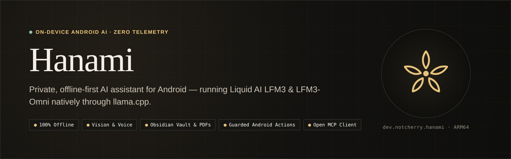
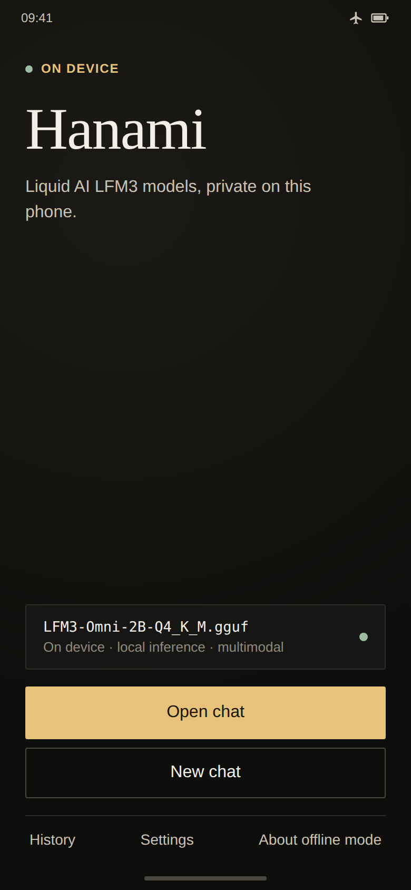
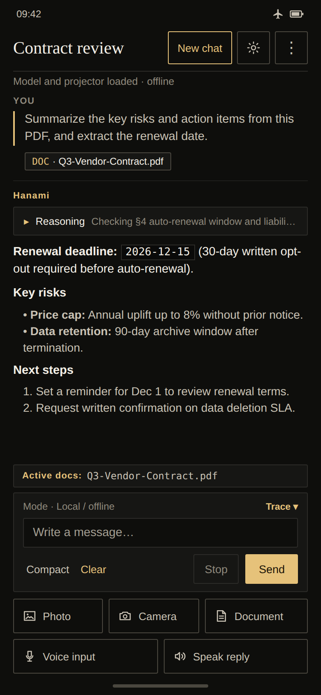
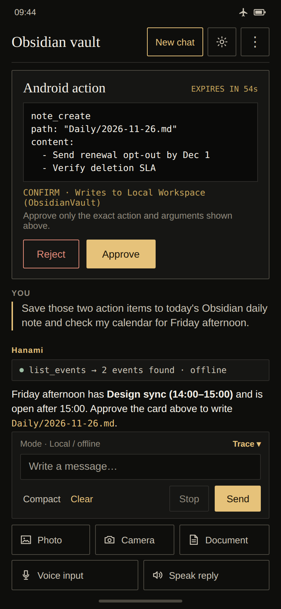
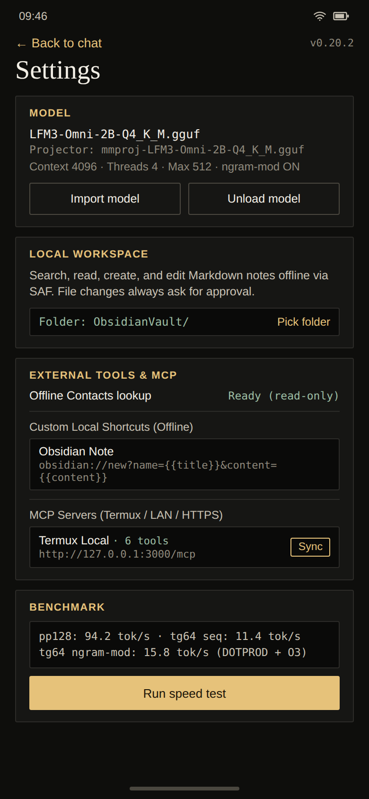

<div align="center">



<br />
<br />

**Your private, offline-first AI assistant for Android — running [Liquid AI](https://www.liquid.ai/) LFM3 &amp; LFM3-Omni natively on your phone.**

*No cloud accounts. No subscriptions. No telemetry. Works in Airplane Mode.*

<br />

[](https://github.com/NotCherry/LFM3Pocket/releases/latest)
[](https://github.com/NotCherry/LFM3Pocket/actions/workflows/build-apk.yml)
[](#download--install)
[](#privacy-security--licensing)
[](LICENSE)

<br />

[Download](#download--install) ·
[Screenshots](#screenshots) ·
[Why Hanami](#why-hanami) ·
[Use Cases](#real-world-use-cases) ·
[Features](#feature-highlights) ·
[Quick Start](#quick-start) ·
[Build from Source](#building-from-source)

</div>

---

## Why Hanami?

Most mobile AI apps send your photos, voice recordings, PDFs, and personal notes to someone else's servers — and stop working the second you lose signal.

**Hanami** puts a fast, multimodal, tool-using AI assistant directly in your pocket using native [llama.cpp](https://github.com/ggml-org/llama.cpp) on Android:

- **Truly offline by default** — Text chat, camera &amp; gallery vision, PDF reading, voice input/output, contacts, calendar, and Markdown vault tools all run locally on your phone with zero internet access and zero telemetry.
- **Tuned for Liquid AI LFM3 &amp; LFM3-Omni** — Compiled for ARM64 with `armv8.2-a+dotprod` and `-O3`, persistent multi-turn KV-cache reuse, `ngram-mod` prompt-lookup decoding, and a built-in speed benchmark.
- **An assistant that acts — only when you say so** — Set timers, alarms, reminders, inspect or update your calendar, draft messages, or write notes to your Obsidian vault. Every side effect shows an explicit one-shot **Approve / Reject** card with exact arguments.
- **Open ecosystem, zero lock-in** — Mount any folder via Android SAF, define offline URI shortcuts, connect an offline **MCP** server in Termux, or opt into your own SearXNG instance and remote HTTPS MCP hubs.
- **Calm, distraction-free Stillwater UI** — Warm charcoal surfaces, readable typography (`Noto Serif Display`, `Inter`, `JetBrains Mono`), collapsible **Reasoning** rail, English &amp; Polish UI, and app-wide **Interface size** scaling (80–130%).

> **Naming note:** **Hanami** is the app (`dev.notcherry.hanami`); **LFM3** is the Liquid AI model family it runs. The GitHub repository keeps its original URL (`NotCherry/LFM3Pocket`).

---

## Screenshots

<div align="center">

| **Home — Ready Offline** | **Multimodal Chat &amp; PDFs** | **Guarded Actions &amp; Vault** | **Workspace, MCP &amp; Speed Test** |
| :---: | :---: | :---: | :---: |
|  |  |  |  |
| Instant model readiness, resume or start fresh, calm Stillwater palette. | Attach PDFs, photos, or voice; inspect collapsible Reasoning and live trace. | One-shot **Approve / Reject** cards for vault edits, calendar, and actions. | Mount your Obsidian folder, sync Termux/HTTPS MCP tools, and benchmark tok/s. |

</div>

<sub>*UI previews rendered using Hanami's exact bundled Stillwater fonts, icons, color tokens, and layouts (`v0.20+`).*</sub>

---

## Real-World Use Cases

### ✈️ Flights, Trains &amp; Off-Grid Travel
Switch on Airplane Mode and keep your assistant. Snap a photo of a street sign or menu with **Camera**, convert units offline, review downloaded itinerary PDFs, or journal your trip — no roaming charges, no dead zones.

### 📓 Your Private Second Brain (Obsidian / Syncthing / Notes)
Open **Settings → Local Workspace** and pick your Obsidian vault or Notes folder. Hanami can search (`fs_search`), list (`fs_list`), and read (`fs_read`) your Markdown files offline — and propose new notes or edits (`note_create`, `fs_append`, `fs_edit`) behind a diff/preview confirmation card before a single byte changes on disk.

### 📄 Instant Local PDF &amp; Document Analyst
Share one or multiple PDFs, Markdown files, or plain-text documents directly from your browser, email, or file manager into Hanami (`Share → Hanami`). Extract contract clauses, summarize receipts, or review sensitive personal notes locally. Thanks to [taint-aware safety (ADR 0025)](docs/adr/0025-taint-aware-tool-confirmation.md), untrusted documents can never silently trigger writes or outbound network calls.

### 🎙️ Hands-Free Personal Assistant (Voice &amp; Default Assistant)
Set Hanami as your **Android Default Assistant** (long-press power button) or tap **Talk** from the notification shade. Ask it to set timers, alarms, or persistent WorkManager reminders, check your calendar, look up an offline contact, or draft an SMS — with spoken read-back and closed `yes/no` voice confirmation before anything fires.

### 🛠️ Termux, Homelab &amp; Developer Workflows (Open MCP + Loopback)
Hanami ships a lightweight, pure-Java **Model Context Protocol (MCP) Streamable HTTP** client with zero proprietary SDK bloat:
- **100% Offline in Termux:** Connect `http://127.0.0.1:3000/mcp` for local Git, Python, SQLite, or shell tooling — even in Airplane Mode.
- **Self-Hosted Homelab (LAN):** Connect Home Assistant, n8n, or MetaMCP over Tailscale/HTTPS or private LAN HTTP.
- **Remote HTTPS MCP Hubs:** Plug in Composio, GitHub, or Notion MCP endpoints with Bearer auth.
- **Local Loopback API:** Optional, off-by-default token-gated `127.0.0.1` prompt endpoint for local automations (cannot approve tools).

### 🔍 Private Web Research on Demand (Opt-In SearXNG)
Stay offline by default. When you need live facts, toggle **Web search** on to query your own HTTPS [SearXNG](https://docs.searxng.org/) instance — results are grounded locally by LFM3 and displayed as clickable source links below the reply.

### 🔐 Confidential Writing &amp; Personal Reflection
Brainstorm sensitive work memos, draft difficult emails, or keep a private journal knowing your prompts stay in local storage — excluded from Android cloud backups and never sent to any third-party training pipeline.

---

## Feature Highlights

### ⚡ On-Device AI &amp; Performance
- **Native `llama.cpp` Engine:** ARM64 build optimized with `-O3` and `GGML_CPU_ARM_ARCH=armv8.2-a+dotprod` for fast Q4_K_M quantization throughput.
- **Multi-Turn KV Cache Reuse:** Avoids re-prefilling conversation history on every turn.
- **Prompt Lookup Decoding (`ngram-mod`):** Speeds up repetitive/editing replies with zero extra draft-model download while verifying every token.
- **Keep Model Loaded &amp; Idle Auto-Unload:** Keep LFM3 warm in the background (with a persistent status notification for **Ask**, **Talk**, **Stop**, and **Unload**) and automatically free RAM after 15 or 60 minutes of idle time.
- **Conversation Compact:** Explicitly summarize long sessions into a rolling context summary while preserving your full saved history.
- **Built-In Speed Test:** Measure prompt-processing (`pp`) and decode (`tg` sequential + `ngram-mod`) tok/s directly inside Settings.

### 👁️ Multimodal, Documents &amp; Speech
- **Vision (LFM3-Omni):** Attach gallery photos or capture straight from the camera; automatic non-destructive photo prep downscales large photos for fast encoding without touching originals.
- **Documents:** Native on-device PDF text extraction plus Markdown &amp; plain-text multi-file attachments, visible attachment pills, and Android Share integration.
- **Flexible On-Device Speech Input:** Use **LFM3-Omni** audio directly, or download the optional **Cactus Whistle STT** (~16.9 MB `.cact`, Apache-2.0 — supports English, Polish, German, French, Spanish, Italian, and Dutch) to dictate into any text-only LFM3 model.
- **On-Device Speech Output:** Listen to replies via **LFM3-Omni** native audio generation, optional **tiny-voca** English neural TTS (~27 MB ONNX pack), or Android system TTS fallback.

### 🧰 Built-In Guarded Tools &amp; Extensibility
All tools use LFM3's native XML tool protocol with deferred `search_tools` discovery and lazy GBNF grammar enforcement so the system prompt stays lean and KV-cache friendly.

| Category | Capabilities | Safety Model |
| :--- | :--- | :--- |
| **Clock &amp; Device** | Timers, alarms, show alarms, persistent reminders (`WorkManager`), flashlight, media/ring/alarm volume, open apps &amp; system settings, copy/share text | Safe helpers run cleanly; alarms, reminders, volume &amp; share require one-shot approval |
| **Calendar &amp; Contacts** | Read/create/update/delete events on a **user-picked writable calendar**; opt-in read-only offline contacts lookup (`lookup_contact`) | Explicit runtime permissions + user-picked calendar; writes always require approval |
| **Messaging** | `draft_message` + `send_message` (SMS or allowlisted share apps) | Opens target app composer for you to review &amp; press send — Hanami never sends silently |
| **Local Workspace** | `fs_list`, `fs_search`, `fs_read`, `note_create`, `fs_append`, `fs_edit`, `fs_delete` inside your SAF-picked folder | Scoped strictly to your chosen folder; all writes require preview/diff approval |
| **Utilities &amp; Opt-In Net** | Current time, safe calculator, unit converter, opt-in allowlisted notification summaries, opt-in Open-Meteo weather, opt-in HTTPS SearXNG `web_search` | Network &amp; notifications off by default; outputs wrapped with `UNTRUSTED_*` boundaries |
| **Shortcuts &amp; MCP** | Custom offline URI shortcuts (`obsidian://`, `geo:`, `mailto:`) + Streamable HTTP **MCP** client (Termux `127.0.0.1`, LAN, HTTPS) | Blocked dangerous URI schemes; every shortcut &amp; MCP call requires explicit approval |

See [`docs/ANDROID_TOOLS.md`](docs/ANDROID_TOOLS.md) and [`docs/MCP_AND_WORKSPACE.md`](docs/MCP_AND_WORKSPACE.md) for the complete protocol, argument schemas, and setup guides.

---

## Download &amp; Install

### Option 1 — Direct APK from GitHub Releases
1. Open the [**Releases**](https://github.com/NotCherry/LFM3Pocket/releases) page.
2. Download the latest signed **`Hanami-v<version>-arm64-v8a.apk`** (and optional `.sha256` checksum).
3. Install on your Android device.

### Option 2 — Automatic Updates with [Obtainium](https://github.com/ImranR98/Obtainium)
1. In Obtainium, tap **Add App** → enter `https://github.com/NotCherry/LFM3Pocket`.
2. Leave **Include prereleases** off for stable versioned builds.
3. Set the APK filter regex to:
   ```text
   Hanami-v.*-arm64-v8a\.apk
   ```

### System Requirements
- **OS:** Android 8.0+ (API 26+, targetSdk 35)
- **CPU:** 64-bit ARM (`arm64-v8a`) with `DOTPROD` (`armv8.2-a+dotprod` — most mid-range/flagship phones from 2019+)
- **RAM:** 4 GB minimum; **6+ GB recommended** for LFM3-Omni (vision + audio)

> **Upgrading from legacy `LFM3Pocket`?**
> Hanami uses install ID `dev.notcherry.hanami`. An older install of `com.notcherry.lfm3pocket` is treated by Android as a separate app and can remain installed side-by-side until you uninstall it.
>
> **Rolling CI builds:** A pre-release debug APK (`Hanami-latest-arm64-debug.apk`) is occasionally rebuilt via manual workflow dispatch for testing; Obtainium's filter above ignores it.

---

## Quick Start

Model weights are **never bundled** in the APK so the installer stays small and you stay in full control of which quantization you run.

1. **Get a Liquid AI LFM3 GGUF model**
   - **Text-only:** Any official quantized LFM3 `.gguf` (e.g. `Q4_K_M`).
   - **Multimodal (Vision + Voice):** Download both `LFM3-Omni-2B-Q4_K_M.gguf` and its matching `mmproj-LFM3-Omni-2B-Q4_K_M.gguf`.
2. **Load it in Hanami**
   - Open **Settings → Model** and tap **Import model** (copies into private app storage) or **Open model from storage** (reads directly in-place without duplicating disk space).
   - For LFM3-Omni, also import or open the matching **Projector** (`mmproj-*.gguf`), then tap **Load model**.
3. **Start chatting offline**
   - Tune **Context** (`512–8192`, default `4096`), **Decode threads** (`1–8`, auto-detected from CPU topology), **Response tokens** (`1–2048`, default `512`), and **Appearance → Interface size** (`Compact` / `Default` / `Large`, or `80–130%`) anytime in Settings.
4. **Unlock optional superpowers (all off by default)**
   - **Local Workspace:** Pick your Obsidian/Notes folder under **Settings → Local Workspace**.
   - **Speech Input / Output:** Download **Cactus Whistle STT** (~16.9 MB) or **tiny-voca** English TTS (~27 MB) directly from Settings (background download with SHA-256 verification).
   - **Web Search:** Add your HTTPS SearXNG `/search` URL (with JSON format enabled) under **Settings → SearXNG**, tap **Test search**, and toggle search on when needed.
   - **External Tools &amp; MCP:** Grant offline Contacts access, add custom URI shortcuts, or sync a local Termux / LAN / HTTPS MCP server under **Settings → External Tools &amp; MCP**.

---

## Privacy, Security &amp; Licensing

- **Zero telemetry:** `LocalDiagnostics` stays strictly on-device (`files/diagnostics.ndjson` and `files/crash-log.txt`). Zero analytics SDKs, zero background tracking, and chat history is excluded from Android cloud backup.
- **Zero-ADB opt-in diagnostics:** Need to report a bug? Open **Settings → Crash Log** to inspect locally, run a temporary **Wi-Fi Log Viewer** on your LAN, or export a sanitized diagnostic report (device specs, RAM/thermal telemetry, timings, crash traces — never chat text, documents, or tokens).
- **Network transparency:** No network request is made unless you explicitly enable **Web search** (your SearXNG URL), **Weather** (Open-Meteo), a remote **MCP server**, or tap an explicit **Download** button for optional Whistle STT / tiny-voca speech packs.
- **Guarded execution:** Model proposals expire after 60 seconds, cannot forge user authority, and sensitive writes or document-tainted turns always require explicit human approval ([`docs/ANDROID_TOOLS.md`](docs/ANDROID_TOOLS.md), [ADR 0025](docs/adr/0025-taint-aware-tool-confirmation.md)).
- **Licenses:**
  - Source code: **MIT License** ([`LICENSE`](LICENSE))
  - Bundled fonts (`Noto Serif Display`, `Inter`, `JetBrains Mono`): **SIL OFL 1.1** ([`licenses/fonts/`](licenses/fonts/))
  - Optional Cactus Whistle runtime: **Apache-2.0** ([`licenses/cactus/`](licenses/cactus/))
  - Model weights: governed by each model's respective Liquid AI license.

---

## Building from Source

<details>
<summary><strong>Local build instructions, pinned dependencies, and developer documentation</strong></summary>

<br />

### Prerequisites
- **JDK 17**
- **Android SDK** (compileSdk 35) &amp; **NDK 27** (`27.2.12479018`)
- **Gradle 8.13**

### Build the ARM64 Phone APK
```bash
# 1. Fetch pinned llama.cpp (v0.8.0 / 8642541b255bfb5dc39cd351a178be09013a55d6)
bash scripts/fetch-llama.sh

# 2. Fetch pinned Cactus Whistle ARM64 runtime (optional for smoke builds, required for release)
bash scripts/fetch-cactus.sh

# 3. Assemble phone ARM64 APK
gradle :app:assemblePhoneDebug
```

A `vMAJOR.MINOR.PATCH` tag on `HEAD` sets `versionName` and `versionCode` automatically (`0.1.0` / `1000` when untagged). GitHub Actions runs JVM unit contracts, builds the ARM64 APK, and runs an `x86_64` emulator smoke suite through the JNI generation path.

### Documentation Index
| Document | Topic |
| :--- | :--- |
| [`docs/DESIGN.md`](docs/DESIGN.md) | Stillwater / Atlas design system, color tokens, typography &amp; component specs |
| [`docs/ANDROID_TOOLS.md`](docs/ANDROID_TOOLS.md) | Validated Android tool protocol, XML/JSON schemas &amp; one-shot consent |
| [`docs/MCP_AND_WORKSPACE.md`](docs/MCP_AND_WORKSPACE.md) | Offline SAF workspace vault, contacts, custom shortcuts &amp; open MCP client |
| [`docs/PERF_ARM64.md`](docs/PERF_ARM64.md) | ARM64 `armv8.2-a+dotprod`, `-O3`, KV reuse &amp; `ngram-mod` performance notes |
| [`docs/CACTUS_WHISTLE_STT.md`](docs/CACTUS_WHISTLE_STT.md) | Optional on-device Cactus Whistle speech-to-text integration |
| [`docs/VOICE_OUTPUT.md`](docs/VOICE_OUTPUT.md) | Local LFM3-Omni, `tiny-voca`, and system TTS speech output |
| [`docs/DIAGNOSTICS.md`](docs/DIAGNOSTICS.md) | Local-only diagnostics, crash log &amp; ARM64 benchmark protocol |
| [`docs/RELEASE.md`](docs/RELEASE.md) &amp; [`docs/RELEASING.md`](docs/RELEASING.md) | Stage 1 CI release gates, APK signing, Obtainium, IzzyOnDroid &amp; F-Droid |
| [`docs/UI_ACCEPTANCE_MATRIX.md`](docs/UI_ACCEPTANCE_MATRIX.md) &amp; [`docs/UI_E2E_CONTRACT.md`](docs/UI_E2E_CONTRACT.md) | UI acceptance criteria (`UT-01..UT-08`) and E2E selector contract |
| [`docs/adr/README.md`](docs/adr/README.md) | Architecture Decision Records (ADRs 0001–0025) |

</details>
