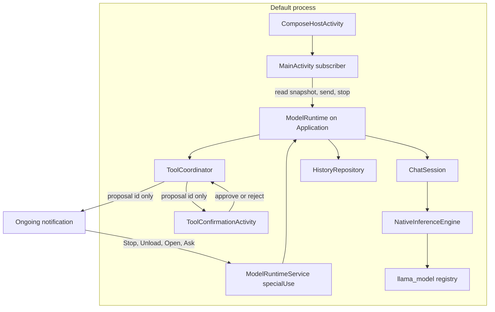

# Background mode

Status: **implemented** for Phases 1–2 plus the generate-path tool bridge, share/ASK intents, and opt-in loopback. This document remains the design record; it does not change the app by itself.

| Landed | PR |
| --- | --- |
| Stillwater UI baseline | [#141](https://github.com/NotCherry/LFM3Pocket/pull/141) |
| Phase 1 residency + N2 notification (Stop / Unload / Open) | [#143](https://github.com/NotCherry/LFM3Pocket/pull/143) |
| Hanami rename / shared prefs file | [#145](https://github.com/NotCherry/LFM3Pocket/pull/145) |
| Auto-release on merge to `main` | [#146](https://github.com/NotCherry/LFM3Pocket/pull/146) |
| Phase 2 Ask / consent shade, tool bridge, share+ASK, loopback, `a3031ea` service start | [#147](https://github.com/NotCherry/LFM3Pocket/pull/147) |

Deferred / out of path: Phase 3 (`:model` process), accessibility service, shell bridge, LAN bind, F-Droid placeholders, `HANAMI_*` signing secrets (unsigned releases until set), repo rename.

Baseline when this plan was written: `main` at `016be76`. Implementation followed the Variant A recommendation on the UI that landed with #141.

The app today is an on-device LFM3 chat (`minSdk` 26, `targetSdk` 35, `compileSdk` 35) distributed as a GitHub Release APK. Weights stay in private storage. Optional SearXNG search is the only network use. Tool calls are an allowlisted, consent-gated set (`toggle_flashlight`, volume, timer, alarm, open app, open settings, copy, share).

The milestone asked for here:

1. The loaded model stays resident by default, and a reply already in progress keeps generating after the user leaves the app.
2. A persistent notification tells the user the app is working and holding resources, with short actions (stop, unload, and a few day-to-day controls).
3. Later, the same runtime can act on the phone, on installed apps, and on other devices, still through the existing approve/reject model.

"Stays loaded" means the process keeps the `llama_model` across leaving chat, the Home screen, and the screen turning off. It does not mean the weights survive a force-stop, a swipe from Recents, or the low-memory killer. Those kill the process. The next open reloads the GGUF from private storage, which is what chat already does on a cold start.

## Current state

### Where the model lives

| Piece | Owner today | Survives leaving the chat screen? |
| --- | --- | --- |
| `llama_model` and optional `mtmd` projector | Process-global native registry in `app/src/main/cpp/native.cpp`, keyed by a `jlong` | Only while that process stays alive **and** Java still holds the handle |
| Java handle (`modelHandle`) | Field on `MainActivity` | No. `onDestroy` unloads it |
| `NativeInferenceEngine` | `MainActivity` calls `Lfm3PocketApplication.newInferenceSession()`, which constructs a new engine. `Application.inferenceEngine()` exists and is not what chat uses | No |
| `llama_context`, sampler, batch | Created inside `generateUtf8` / `generateSpeechUtf8` and freed with `llama_free` before the JNI call returns | No. Idle residency is the weights, not the KV cache |
| Decode thread | `MainActivity`'s single-thread `worker`. The same executor imports GGUF, loads, generates, and writes tool history | The thread dies with the activity's `worker.shutdown()` |
| Stop flag | `ModelHandle.cancelled`, checked by llama's abort callback and the decode loop. `requestStop(handle)` sets it. A second generate on the same handle fails with "Model is already generating" (`decode_mutex` try-lock) | Flag is per handle |
| Prompt and partial reply | In-memory `ChatSession.messages`. Room stores a **completed** turn. The README states that old conversations are not injected into a new session | No. Destroying the activity drops the live prompt. History still has finished turns |
| Inference limits | DataStore `inference_settings` (context 512–8192, threads 1–8, max tokens 1–2048). Applied on the next response | Yes, the file does |
| Selected GGUF paths, SearXNG endpoint, conversation id | `MainActivity.getPreferences()` (`MainActivity` private prefs: `model`, `mmproj`, names, `search_endpoint`, `search_enabled`, history id and title) | The file does. A headless service cannot see them unless it opens that same prefs file or they move to an application store |
| Tool authorization | One `ToolCoordinator` on the `Application`. Proposals expire after 60 seconds (monotonic clock), cap 32 pending, 64 remembered outcomes. Process death drops them and fails closed | The coordinator survives activity recreation. It does not survive process death |
| Consent UI | Chat card via `MainActivity.presentToolOutcome`, and non-exported `ToolConfirmationActivity` (intent carries only `proposal_id`) | Both need a living activity |
| Memory pressure | `Lfm3PocketApplication.onTrimMemory` writes a diagnostic line. It does not unload | n/a |
| Microphone | `RecordingController`, cancelled in `MainActivity.onStop` | Recording stops on leave, on purpose |
| Speech playback | `PlaybackController` owned by the activity, closed in `onDestroy` | Stops when the activity is destroyed |

Native load is CPU-only (`n_gpu_layers = 0`). llama.cpp's default mmap can apply, so idle weight pages are file-backed and the kernel may reclaim them under pressure. The next token then faults them back in. Nothing in the app calls `mlock`. That should stay: pinning multi-gigabyte weights fights the low-memory killer.

### What "leave the app" does today

`MainActivity.onStop` sets `foreground = false` and cancels an in-progress recording. It does **not** call `session.stop()` or `unloadModel`. A reply already running on `worker` is allowed to continue for as long as the process is actually scheduled.

That window is short, and it is not under the app's control:

- The launcher is `ComposeHostActivity`. Chat is a separate, non-exported `MainActivity`. Back from chat finishes it. `onDestroy` calls `session.close()` (which cancels the turn), then `inferenceEngine.stop()`, then `unloadModel` on `worker`.
- There is no `android:configChanges` entry. Rotation destroys the activity, unloads, and the new instance loads the GGUF again. The old unload and the new load can overlap, so peak RAM is briefly two copies of the weights.
- After the last activity stops, the process is cached. Android's cached-app freezer can suspend every thread. The app never asked to pause; the freezer pauses it anyway.
- A cached process holding a multi-gigabyte model is an early low-memory-killer target. `onTrimMemory` only logs.
- There is no foreground service, no partial wake lock, and no notification. The manifest has `INTERNET`, `RECORD_AUDIO`, `CAMERA`, `MODIFY_AUDIO_SETTINGS`, and `SET_ALARM`. It has no `FOREGROUND_SERVICE_*` permission and no `<service>`.
- Doze and OEM battery managers (Samsung sleeping apps, Xiaomi, and similar) are free to defer or kill this process. SearXNG inside an in-flight turn needs a network that Doze may already have suspended.

So a Home press sometimes lets a few more tokens land, and then the phone freezes or kills the process. Leaving chat back to Home unloads immediately. The user gets no control surface either way.

### Tool consent, as it actually behaves

`ToolRegistry.parse` accepts one strict JSON object and returns an immutable request or a rejection. Parsing does not authorize anything. `ToolCoordinator.propose(request, source)` is the only authorization path:

- App code supplies `source`. JSON cannot claim it.
- `USER_ACTION` plus `Risk.SAFE` runs immediately. That source means an explicit app control with those exact arguments, not an ordinary chat line.
- `MODEL_PROPOSAL` always waits for approve/reject, including flashlight, timer, music volume, and opening an app, which are classified `SAFE`. Alarm, non-music volume, copy, and share are `CONFIRM`.
- `IMAGE`, `WEB_SEARCH`, `DOCUMENT`, `BACKGROUND`, and `UNKNOWN` return `UNTRUSTED_SOURCE` and do not execute. `BACKGROUND` is already in the enum, and it is deliberately fail-closed.
- Approve consumes the proposal. Replay, expiry, and a missing permission do nothing. Back from `ToolConfirmationActivity` rejects a still-pending proposal.
- Handlers are installed on the `Application` (flashlight, volume, timer, alarm, launcher activity, fixed settings pages, clipboard, share sheet). Several of them call `startActivity`. From a background service that call is blocked by the background-activity-start rules (Android 10+). It works when a foreground activity or a notification `PendingIntent` the user just tapped is the caller.

The chat loop does not yet parse model text into `propose`. `presentToolOutcome` is what instrumentation uses to drive the card. The allowlist, the coordinator, and the sheet are real. The bridge from a generated reply to a proposal is not in the shipping generate path. Background mode must not invent a second, looser bridge.

## What has to change for the milestone

1. Move the handle, the engine, `ChatSession`, and the decode executor off `MainActivity` and onto a process-scoped runtime the `Application` owns. Activity `onDestroy` stops being "unload and cancel".
2. Promote that process to a foreground service **while the activity is still started** (model load finished, or a turn started). Starting the service from `onStop` throws `ForegroundServiceStartNotAllowedException` on Android 12+ once the app is no longer eligible.
3. Keep one decode owner. Two engines in one process can each hold a `llama_model`; the try-lock only serializes a single handle.
4. Point the notification and the reopened chat UI at the same `ChatSnapshot`. The activity becomes a subscriber. `snapshot()` is already safe to read.
5. Move `model` / `mmproj` / search / conversation id out of activity-private prefs into an application store (or teach the service to open the existing `MainActivity` prefs file once, then migrate). A service that cannot see the path cannot reload after a kill, and it cannot unload the file the UI loaded.
6. Leave `Source.BACKGROUND` rejected. Notification buttons the user taps are `USER_ACTION` for stop, unload, and the text of a quick ask. A tool call inside the model's answer is still `MODEL_PROPOSAL`.

Microphone capture stays cancelled when the activity stops. Background mic needs the `microphone` service type, a visible capture indicator, and a Play declaration this milestone does not need. In-progress **text** generation continues. In-progress spoken playback should continue with it (same "don't stop on leave" rule); new recordings do not start from the shade.

## Runtime variants

### Variant A — in-process foreground service (recommended)

A `ModelRuntime` on `Lfm3PocketApplication` owns the engine, the handle, one single-thread decode executor, and the `ChatSession`. `ModelRuntimeService` is a started service in the **default** process (`exported=false`). The UI binds or registers a listener. The service calls `startForeground` as soon as it starts.

Service type:

- Manifest: `android:foregroundServiceType="specialUse|mediaPlayback"`.
- `android.app.PROPERTY_SPECIAL_USE_FGS_SUBTYPE` = `on_device_language_model`, with a one-paragraph explanation that the phone is holding a user-imported language model in memory and running user-requested generation.
- `startForeground` is passed `FOREGROUND_SERVICE_TYPE_SPECIAL_USE` while the model is resident or a text turn is running.
- While `PlaybackController` is playing, the same service adds `FOREGROUND_SERVICE_TYPE_MEDIA_PLAYBACK` and drops it when playback stops. Speech is the legitimate media case. Text generation is not declared as media playback.
- No `microphone`, `camera`, or `dataSync` type in this variant.

`START_NOT_STICKY`. If the low-memory killer reclaims the process, it stays dead until the user opens the app or, later, taps a leftover notification that is already gone. A sticky restart would reload multi-gigabyte weights in the background, often onto a phone that just proved it cannot keep them, and on Android 12+ the restarted service only gets a brief exemption to call `startForeground`. Calling `startForeground` first and loading second is possible. It is the wrong default.

Partial wake lock: hold one only while a turn or spoken playback is running. Release it when the model is merely resident. The foreground service is what keeps the cached-app freezer from suspending the process. A wake lock on top of an idle model keeps CPUs from sleeping for no decode.

Idle policy lives in the runtime, not in the activity. See notification defaults below. On `TRIM_MEMORY_RUNNING_CRITICAL`, unload immediately if no turn is running. If a turn is running, remember the callback and let that turn finish; a second critical callback cancels the turn and unloads. `TRIM_MEMORY_COMPLETE` cancels and unloads immediately. Do not `mlock`.

Thermal (`PowerManager` thermal status, API 29+, guarded because `minSdk` is 26):

- `MODERATE`: notification line only.
- `SEVERE`: finish the current turn, refuse new ones, unload when it ends.
- `CRITICAL` and above: cancel the turn and unload now.

Battery under about 15%: notification warning, no automatic unload. The user asked for the model to keep working.

New conversation and Clear keep their current meaning (stop this prompt, drop in-memory messages) and they remain explicit UI actions. The notification's Open action returns to the live session, not to a blank one. `ComposeHostActivity`'s "new conversation" extra starts a new session only when no turn is active; when one is active, the UI asks before stopping it.

**Meets the milestone.** One process, no Binder streaming, native code unchanged. `ChatSession`, `ToolCoordinator`, and Room stay where tests already construct them.

**Costs.** The UI and the weights share an oom bucket. A large model can still take the whole app down, including a consent sheet that was open. Play may reject `specialUse` (below). Residency stays visible: `startForeground` needs a posted notification, and if the user blocks the channel, recent Android versions replace it with a generic "app is running" notice. There is no supported way to hold the weights in the background with the shade empty.

### Variant B — separate `:model` process, bound plus foreground

Same service as A, with `android:process=":model"`. The UI process binds to it. Tokens cross Binder. Tool execution that needs an activity (`open_application`, `open_settings`, `share_text`) stays in the UI process; the model process only forwards the proposal id.

**Gains.** The UI process can be reclaimed while the weights live. A Compose crash does not free the model. Memory accounting for the model is obvious in dumpsys.

**Costs.** A second `Application.onCreate`, a second copy of the native library, and an AIDL or Messenger stream. The native registry is process-global, so the UI process must not also call `loadModel`. `ToolCoordinator` has to pick a home: if it stays in the UI process, a UI-process kill loses pending proposals (fail closed, which is safe); if it moves to `:model`, activity launches need a callback into a process that may be dead. Instrumentation today installs a test `Application` in the default process. A second process doubles that harness. Binder transactions are fine for token pieces (they are small) and awkward for PCM speech (chunk explicitly, stay under the transaction limit).

This is the right follow-up if field devices show the UI process dying while a turn runs. It is a poor first step: Variant A produces the user-visible behavior, and B can wrap the same `ModelRuntime` behind a binder later if the runtime has no `Activity` references.

### Variant C — WorkManager

WorkManager's long-running worker is documented for "crunching on an ML model locally". Under the hood it is still a foreground service, scheduled through `JobScheduler`. Android 16 adds a job quota that long-running workers can exhaust; the platform guidance when that happens is to start the foreground service yourself.

A worker fits a **finite** job: one import, one forced unload, one history-media cleanup. It does not fit a resident model. Between jobs the process may die, and with it the weights. Expedited work is quota-limited and short. Doze defers ordinary workers. There is no supported way to say "keep this `llama_model` mapped until the user says otherwise" in WorkManager without holding a single worker open for the whole residency, which is Variant A with an extra scheduler and a quota.

Use WorkManager only as a helper later (retry a history write, delete `.partial` imports). Do not put generation or residency on it.

### Variant D — Play-conservative, generation only

Foreground service type `dataSync`, started when the user sends a message, stopped when the turn ends, model unloaded when the activity stops. `onTimeout(int, int)` calls `stopSelf()` immediately.

This matches Play's published `dataSync` examples (user-started local processing) better than `specialUse` does. On Android 15 (`targetSdk` 35, which this app already sets) `dataSync` and `mediaProcessing` share a **6-hour-per-24-hour** budget **per type** while the app is backgrounded. Bringing the app to the foreground resets that type's timer. When the budget is gone, `onTimeout` fires and the service has a few seconds to stop or the system throws `RemoteServiceException` ("did not stop within its timeout"). A further `startForegroundService` of that type throws `ForegroundServiceStartNotAllowedException` until the user opens the app. `shortService` is tighter still (on the order of three minutes, then an ANR) and cannot cover a long reply.

Variant D fails the milestone on purpose: the model does not stay loaded, and a reply survives leaving only until that one turn ends. It is the fallback if Play rejects `specialUse` and sideloading is no longer the distribution channel.

`mediaProcessing` is not a better name for text decode. Play's description is transcoding. Spoken-reply **playback** is `mediaPlayback`. Spoken-reply **generation** is still the language-model runtime.

### Comparison

| | A. In-process `specialUse` | B. `:model` process | C. WorkManager | D. `dataSync` per turn |
| --- | --- | --- | --- | --- |
| Reply continues after Home | Yes, while the process lives | Yes | Only inside one worker execution | Yes, for that turn |
| Model stays mapped after the reply | Yes, until unload / idle / thermal / trim | Yes | No | No |
| Android 15 time limit | No `specialUse` timeout of the 6-hour kind | Same as A | Job quota; Android 16 can exhaust it | 6 h / 24 h per type, then hard stop |
| Low-memory killer | Foreground-service adj, still killable | Model process killable on its own; UI may die first | Process is important only while the worker runs | Important only during the turn |
| Doze / freezer | Foreground service stays schedulable. Release the wake lock when idle. Network for SearXNG can still fail on OEM skins; search already fails soft | Same | Deferred | Exempt only while the turn's service runs |
| Notification required | Yes, the whole residency | Yes | Yes, WorkManager's | Yes, during the turn |
| Play story | Must justify `specialUse`. Rejection risk | Same, plus a second process to explain | Credible for one finite ML job. Not for residency | Closest to a published allowed use. Does not meet "stay loaded" |
| Effort | Medium. Ownership move, one service, prefs migration. Native unchanged | Large. AIDL, two processes, tests | Small, and the wrong shape | Medium, and a product retreat |
| Fits this codebase | Session, coordinator, and JNI stay in-process | Coordinator and `startActivity` tools straddle processes | Ignores the handle and the session | Keeps today's "unload on leave" |

### Platform constraints that apply to every variant

**Android 12–14 foreground-service start rules.** The app must declare the type and the matching `FOREGROUND_SERVICE_*` permission (`FOREGROUND_SERVICE` plus the type permission). `startForeground` has to run within a few seconds of `startForegroundService`. Types the user thinks of as "while in use" (camera, microphone, location) cannot be started from the background. `specialUse` and `dataSync` should be started while the activity is still started. `BOOT_COMPLETED` cannot launch several types on Android 15, including `dataSync`. This app should not start a model service from boot.

**Android 15 (`targetSdk` 35).** The 6-hour `dataSync` / `mediaProcessing` budget above. Implement `onTimeout` even if the chosen type is `specialUse`, and make it unload and `stopSelf()`, so a future type change cannot crash the process. `SYSTEM_ALERT_WINDOW` is not a back door and should not be added.

**Android 16.** Long-running WorkManager jobs count against job quota. Progress-style notifications and promoted live updates exist (notification section). Neither removes the need for a foreground service. `compileSdk` is 35 today; `Notification.ProgressStyle` needs a later compile against API 36. Leave `targetSdk` at 35 until those behavior changes are audited. Do not bump it inside the residency work.

**Notifications permission.** `POST_NOTIFICATIONS` is a runtime permission from API 33. Foreground-service notifications are exempt: the ongoing "model loaded / generating" notice still shows if the user denies the permission. Any **second** notice (reply ready, a separate consent ping) does not. Ask for the permission the first time the user enables quick ask or "tell me when the reply is done". Put consent text on the foreground-service notification itself so a denial cannot hide an approval request.

**Doze and battery optimization.** A foreground service keeps the process out of the cached freezer and, on AOSP, exempts it from app-standby deferral for the service's lifetime. OEM killers still exist. Do not call `ACTION_REQUEST_IGNORE_BATTERY_OPTIMIZATIONS` on first launch. After the feature ships, a Settings row can open the system battery screen if a device is observed stalling generations with the screen off. That row is user-initiated and explains why.

**Play policy.** [Play's foreground-service declaration](https://support.google.com/googleplay/android-developer/answer/13392821) lists acceptable uses per type and asks for a video of the user starting the work. `dataSync` must be user-initiated and finite. `specialUse` is the bucket for a real use that matches no other type, with a free-text subtype reviewers read. "Keep a chat model mapped so the next question is fast" is true, and it is not one of the published examples. Current distribution is GitHub Releases, so Variant A can ship sideloaded while the declaration is drafted. A Play submission should carry the declaration, the video, and Variant D as the prepared retreat. Full-screen intents are for calls and alarms; do not use one to pop the consent sheet.

**Thermal and memory.** Generation is a sustained CPU load on 1–8 threads. The notification is the disclosure. The thermal ladder above is the automatic response. Idle residency is much cheaper than a turn (the context is freed after every `generateUtf8`) and is still hundreds of megabytes to a few gigabytes of mapped weights on a phone the README already describes as 4 GB minimum, 6 GB preferred.

## Notification

One ongoing notification, one id, channel importance `LOW` so token updates do not chime. `setOnlyAlertOnce(true)`. `setOngoing(true)` so a swipe does not remove the only control surface. A dedicated channel (`model_runtime`) so the user can quiet it without blocking a future high-importance "needs approval" channel.

The shade shows at most three actions. Anything past that belongs in the app.

### Action sets

**N1 — fixed.** Stop, Unload, Open. Always. Quick ask and progress live only inside chat. Simplest, and it omits the daily "ask without opening" control.

**N2 — state-dependent (recommended).** Three actions, chosen from the runtime state:

| State | Title | Text | Actions |
| --- | --- | --- | --- |
| Generating | Generating | First line of the question, tokens so far, tokens/s, `n / maxTokens` | Stop, Open |
| Speaking | Speaking | "Playing the spoken reply" | Stop, Open |
| Idle, model mapped | Model loaded | File name, "Using memory", idle timer if one is set | Ask, Unload, Open |
| Needs approval | Approval needed | `ToolCoordinator.describe(request)` in `BigTextStyle` | Review. Approve on the shade only when the tool is `SAFE` **and** the full description fits; otherwise Review opens `ToolConfirmationActivity` |
| Warm / low battery | same state as above | Extra line: "Phone is warm" or "Battery low" | Unload stays available |
| No model | notification gone | Service stopped | — |

Stop calls the same path as chat Stop (`session.stop()` / `requestStop`). It does not unload.

Unload calls `requestStop` if a turn is running, waits for decode to leave `decode_mutex`, then `unloadModel`, then `stopForeground` and `stopSelf`. The button is a `USER_ACTION`. It does not go through `ToolRegistry`.

Open is a `PendingIntent` to `MainActivity` for the **live** conversation id (`FLAG_ACTIVITY_SINGLE_TOP` or reorder-to-front). Tap on the notification body does the same.

Ask is `RemoteInput` on a non-exported receiver. The reply text is the user's. `submit` already returns false when a turn is active or the handle is 0; the notification then updates to "Still answering" and does not queue. No second queue in the first version. The receiver's `PendingIntent` has to be mutable; Stop, Unload, Open, Approve, and Reject stay immutable. Extras never contain tool arguments, only a proposal id, matching `ToolConfirmationActivity`.

Approve / Reject on the shade call `approve(id)` / `reject(id)`. They are explicit user controls for that id. They do not mark the source as `USER_ACTION` in a way that would skip the coordinator: the proposal was created as `MODEL_PROPOSAL`, and only `approve` runs it. `CONFIRM` tools (alarm, clipboard, share, non-music volume) and any description that would be truncated open the sheet instead. Share, settings, and open-app still need a foreground activity; the Review tap is that activity, and the handler runs `startActivity` from it.

**N3 — Android 16 live update, on top of N2.** For the generating state only, on API 36+:

- `Notification.ProgressStyle` with one segment, progress = token callbacks / `maxTokens`. Early end-of-generation sets the bar complete.
- `setShortCriticalText` for the status chip, kept to a handful of characters (`42 t/s` or a percent).
- Request promotion (`EXTRA_REQUEST_PROMOTED_ONGOING` / `setRequestPromotedOngoing`) only while a turn is running. Promoted live updates are for a user-started activity with a start and an end. The idle "model loaded" notice stays an ordinary ongoing notification. Using a live update as a permanent launcher is the case the platform docs call out as inappropriate.
- Requirements that matter: ongoing, a content title, no custom `RemoteViews`, not colorized, channel above `IMPORTANCE_MIN`, install-time `POST_PROMOTED_NOTIFICATIONS`. The user can turn live updates off for the app (`canPostPromotedNotifications`).
- Below API 36, N2's text line carries the same numbers. No behavioral fork.

Token rate needs no JNI change. The decode loop delivers one piece per sampled token via `onToken`. Count those callbacks over a one-second window. Label it tokens/s. A split multi-byte piece is rare; if it happens the rate is slightly high for that second, which is acceptable on a notification.

Pause is not a separate engine feature. Cancel frees the `llama_context` at the end of the JNI call. There is no KV cache to resume. A Pause action would stop the turn, keep the weights, and leave a `CANCELLED` transcript, which is what Stop already does. Ship one button. A later "continue this answer" is a new user message, not a resume.

### Tap, swipe, and process death

- Tap and Open: chat on the live session.
- Swipe: `setOngoing(true)` so a casual swipe leaves the notice in place on current Android. Also set `deleteIntent` to unload. If a platform version delivers the dismissal anyway, the weights must not stay mapped after the disclosure is gone.
- The system's stop control for a foreground service, or a force-stop: service or process death. Treat a service stop as unload plus cancel. Do not restart.
- Lock screen: `VISIBILITY_PRIVATE` by default, so the question and the partial reply are hidden until the phone is unlocked. A setting can make the generating text public.

### Defaults and settings

Recommended defaults, all of them settings:

| Setting | Default | Why |
| --- | --- | --- |
| Keep the model loaded when I leave | On | This is the milestone |
| Unload after idle | Off | A timer that fires while the user expects the model to stay will feel like a bug. Offer 15 minutes and 60 minutes |
| Notification | On whenever the model is mapped or a turn is running | Required for the foreground service. No "hide it" switch |
| Preview on the lock screen | Off | Private transcripts |
| Quick ask | Off until `POST_NOTIFICATIONS` is granted, then On | The input itself can ride the foreground-service notification; the permission is for a decent keyboard UI and for a "reply ready" follow-up |
| Tell me when a reply finishes | Off | Needs `POST_NOTIFICATIONS`. The ongoing notice already flips to "Reply ready" |
| Warm-phone warning | On | Copy only at `MODERATE`; the unload ladder at `SEVERE`+ is not optional in v1 |
| Ignore battery optimizations | Not requested | Settings link only, later, if a device needs it |

Idle means no generation, no playback, no pending consent. Opening the app does not by itself reset a timer; a turn or an Ask does. "Off" still yields to Unload, thermal `SEVERE`+, and trim.

Prefs and DataStore keys for these live next to inference settings, application-scoped.

### Consent timing

Sixty seconds is too short once the user has left the phone. Recommended change, limited to proposals that have been posted on the foreground notification: hold the proposal for 10 minutes or until Approve, Reject, or Review, whichever comes first. The in-app card can keep 60 seconds. Process death still drops the proposal. Do not extend the clock for `IMAGE` or `WEB_SEARCH` sources; those never become proposals.

## Phone, apps, and other devices

Every row below reuses `ToolRegistry` + `ToolCoordinator`. New powers are new typed tools, or a new **input** into `ChatSession.submit`. None of them flip `Source.BACKGROUND` to trusted. Screen text, notification text, web pages, and MCP results are untrusted content: they may be shown to the model as data, and they cannot authorize an action. That is the same rule image and search text already follow.

| Path | What it can do | Permission and consent | Play | Effort | Recommendation |
| --- | --- | --- | --- | --- | --- |
| **More allowlisted intents** | The tools that already exist, plus a closed set of new ones (user-pinned shortcuts only, fixed share targets). The model names a package or a page from the schema. It never supplies an action string or a component | Same coordinator. `MODEL_PROPOSAL` always confirms. Launches happen from a foreground activity or from the notification tap that just approved. Background `startActivity` stays illegal | Fine. This is the current design | Medium per small batch of tools | First phone-side step, after residency |
| **Share target and `ACTION_SEND`** | Another app sends text (and later an image) into a new or the live session. Direct Share shortcut | The share is the user typing a question. Tool calls inside the answer are still `MODEL_PROPOSAL`. No blanket "share means approve tools" | Fine | Small | Do it with the quick-ask work. High daily value |
| **App shortcuts** | Static or dynamic "Ask LFM3" shortcut, optionally a pinned shortcut the user created | User-invoked. Same as opening chat with a draft | Fine | Small | With the share target |
| **Notification listener** | Read notifications the user opted in, so they can ask "what did I miss?" | `BIND_NOTIFICATION_LISTENER_SERVICE`, user enables it in system settings. Per-app opt-in inside LFM3. Text enters the prompt only when the user asks. It is not a tool source | Allowed for real notification helpers, scrutinized. Easy to look like spyware if it is on by default | Medium | Later, default off, summarize-on-request only |
| **Assistant / voice-interaction role** | The user sets LFM3 as the assistant. System gesture opens a session | Default-assistant role or `VoiceInteractionService`. Does not grant control of other apps. Cold model load fights the assistant latency budget unless Variant A is already resident | Feasible if the app really is an assistant | Large | After residency is solid. Not a control channel |
| **App Functions (Android 16) and older App Actions** | Typed functions published by other apps, or a function this app publishes ("ask the local model") | Each call is a schema entry with consent. Inbound prompts from other apps are untrusted user text, confirmed before any side effect | The platform-supported replacement for scraping other apps' UIs | Medium once the API is stable. `compileSdk` 36 | Preferred long-term "talk to installed apps" path. Watch it; do not block residency on it |
| **Accessibility service** | Read the focused UI, click, type, scroll, drive apps that have no API | `BIND_ACCESSIBILITY_SERVICE`, user turns it on in Settings. Every click is a `CONFIRM` tool with the target text stored in the proposal. On-screen text is untrusted (`DOCUMENT` / `IMAGE` class), never an authorizer. Prompt injection from a web page becomes "tap Send" | Poor. Play expects accessibility services to help users with disabilities, and rejects general automation. This distribution can sideload; a Play build should not ship it | Large, and hostile to review | Not on the recommended path. Documented so it is an explicit decision, not an accidental one |
| **Loopback API** | A program on the phone calls `127.0.0.1` to submit a prompt and stream tokens | Off by default. Bind `127.0.0.1` only. Pairing token in app-private storage, rotated from Settings. The socket can submit text. It cannot call `approve`. Consent stays on the phone UI | Fine if it is off and local. A service that listens on the LAN is a different product | Medium | The external-device foot in the door |
| **MCP server** | Same as loopback, speaking MCP, tools mapped 1:1 onto `ToolRegistry` names | A remote MCP client must not be able to approve. Tool **results** that arrive from a server the model called are untrusted, same as SearXNG snippets | Fine on loopback. A LAN MCP server needs a separate consent and a clear "other devices can send prompts" setting | Medium on top of loopback | After loopback, not before |
| **MCP client** | The model calls a user-configured MCP server, analogous to the SearXNG endpoint | Endpoint opt-in, HTTPS or an explicit local exception, same fail-soft pattern as search. Results cannot authorize Android tools | Fine | Medium | Same pattern as search. Independent of the server |
| **ADB-style shell bridge** | Arbitrary commands from a desktop | Would bypass the allowlist | Not acceptable | — | Do not build. A desktop companion uses the loopback methods |
| **Wear / desktop companion** | A watch or desktop sends a prompt and shows the reply | Paired device, same token model as loopback, consent still on the phone for side effects | Fine as a client of the local API | Large, mostly product | After the loopback API is stable |

Search stays as it is: the user opts into an endpoint, the question is sent only when search is on, and snippets are untrusted context.

## Recommended path

**Ship Variant A and notification set N2.** Add N3 when `compileSdk` moves to 36. Keep Variant B as a drawing of the next runtime cut, not as part of the first change. Keep Variant D written down as the Play retreat. Use WorkManager only for housekeeping.

### Phase 1 — residency and the notification

**Done in #143.** Size was medium. One ownership move. Native code unchanged.

- Extract `ModelRuntime` so `MainActivity` no longer constructs the engine, the session, or the decode executor, and no longer unloads in `onDestroy`.
- `ModelRuntimeService` as in Variant A, started while the UI is still in the foreground, `START_NOT_STICKY`.
- Migrate model path, projector path, search settings, and the live conversation id to an application-scoped store.
- Notification N2 without RemoteInput yet: Stop, Unload, Open, generating text with tokens/s and `n / maxTokens`, idle text "Model loaded · using memory".
- Settings: keep-loaded (default on), idle unload (default off, choices 15 and 60), lock-screen preview (default private).
- Wake lock only during a turn and during playback. Recording still cancels in `onStop`. Spoken playback in progress keeps running.
- Trim and thermal ladder as specified.
- Reopening chat attaches to the live snapshot. A new conversation while a turn is running asks before it stops that turn.
- Tests: a JVM state machine for load / leave / stop / unload / idle-off / trim / thermal, with a fake engine. One instrumentation check that finishing the chat activity does not unload while keep-loaded is on, if the emulator harness can bind the service. The existing native lifetime tests stay the JNI gate.

Done when: the user loads a model, leaves chat to Home, locks the phone, and comes back to the same mapped model; a reply that was running has finished or is still streaming; the shade can stop it or unload; force-stop still forgets the weights and the next open loads from private storage.

### Phase 2 — shade conversations and consent

**Done in #147** (RemoteInput Ask + shade consent). Size was small to medium. No native change.

- RemoteInput Ask, disabled while a turn is active.
- Consent on the foreground notification, 10-minute hold, Approve on the shade only for short `SAFE` proposals, Review for everything else.
- `POST_NOTIFICATIONS` request tied to quick ask and "reply ready".
- Optional checkpoint of the partial assistant text every few seconds so a kill loses less of a long answer. Room already has a cancelled state. This is the only history-schema question in the phase; skip it if it needs a migration beyond an extra write of the existing turn row.
- Android 16 `ProgressStyle` when `compileSdk` is 36. `targetSdk` stays 35 until that bump is its own change.

### Phase 3 — only if the process actually dies

Size: large.

- Move the same `ModelRuntime` to `:model` (Variant B) if device reports show the UI process killed mid-turn while the service was foreground.
- Do not start this phase on speculation. Phase 1's diagnostic line (`LocalDiagnostics` already records trim) should record unload cause: user, idle, thermal, trim, death.

### Phase 4 — the phone, still allowlisted

**Partially done in #147** (`ModelToolBridge`, share target, typed ASK). Size was medium, in small batches.

- ~~Wire the missing generate-path bridge:~~ a strict parse of a tool JSON object the model emitted, `propose(..., MODEL_PROPOSAL)`, card plus notification. No scraping of prose, which `StrictToolJson` already refuses.
- ~~Share target and typed ASK intent.~~ (Shortcuts / pinned still open.)
- New tools only as new schema rows. No arbitrary intents.
- Notification listener and the assistant role only after an explicit product yes. Accessibility service stays off the roadmap unless the owner accepts sideload-only and per-action confirmation.

### Phase 5 — other devices

**Loopback prompt-in landed in #147** (opt-in, `127.0.0.1`, no approve). Pairing token, token streaming, MCP, and companions remain open. Size was medium for loopback, more for companions.

- ~~Loopback API, off by default, `127.0.0.1`, prompt in, no `approve`.~~ Pairing token and token streaming still open.
- MCP server as a skin on that API. MCP client as a second opt-in endpoint beside SearXNG.
- Wear or desktop as clients of that API. No shell bridge.

## Risks

- **Play rejects `specialUse`.** Mitigation: GitHub Releases first, declaration drafted in parallel, Variant D implemented only if a Play track is actually blocked. Do not preemptively drop residency.
- **OEM kills the foreground service anyway.** The notification disappearing is the honest signal. The battery-settings link is the remedy. Do not sticky-restart the model.
- **RAM.** Idle mmap is smaller than a live context and is still large. Trim unloads. The user can turn keep-loaded off and get today's behavior.
- **Heat and battery during a long turn.** Wake lock is scoped to the turn. Thermal `SEVERE` stops new work. The notification is visible the whole time.
- **Two copies of the weights during the move.** The activity and the runtime must not both call `loadModel`. One owner.
- **Consent from the shade approves the wrong action.** Same rule as the sheet: immutable proposal, id only, full `describe` text, no Approve button when the text does not fit, `CONFIRM` tools open the activity.
- **Quick ask as a confused deputy.** Ask only inserts a user message. It does not set `USER_ACTION` on later tool calls.
- **Background activity launches.** Open-app, settings, and share keep failing closed when no activity is in front. The Review tap is what brings an activity forward.
- **Rotation race, today.** Phase 1 removes it by deleting the unload-on-destroy path. Until that lands, do not "fix" rotation by adding `configChanges` alone; the handle would still be activity-owned and a process kill would still drop it.
- **Accessibility and a LAN listener**, if someone builds them early. They are the two ways this app turns into something the user did not mean to run. They are out of the recommended phases.

## Open decisions

Recommended answers are the defaults Phase 1 should implement if you do not override them.

1. **Distribution for the first build.** Recommended: GitHub Release APK with `specialUse`, Play declaration drafted and not blocking. Override: stay on Variant D until a Play review exists.
2. **Idle unload default.** Recommended: off, with 15-minute and 60-minute choices. Override: default 15 or 60 if you want a forgotten model to release RAM without a tap.
3. **Back to Home.** Recommended: keep the model and the live prompt. Override: unload when chat finishes, and only keep generating across the system Home button.
4. **Pause.** Recommended: do not ship a Pause action; Stop is the capability the engine has. Override: label a second button Pause if you want the word, with the same behavior.
5. **Microphone after leave.** Recommended: keep cancelling capture in `onStop`. Override: `microphone` foreground-service type and a visible capture indicator, as its own project.
6. **Spoken playback after leave.** Recommended: let an in-progress playback finish under `mediaPlayback`. Override: stop playback in `onStop`, as today.
7. **Lock screen.** Recommended: hide question and reply (`VISIBILITY_PRIVATE`). Override: show them.
8. **Quick ask in Phase 1.** Recommended: Phase 2, after Stop / Unload / Open are in users' hands. Override: include `RemoteInput` in Phase 1.
9. **Consent hold while the user is away.** Recommended: 10 minutes for proposals posted on the foreground notification, 60 seconds for the in-app card. Override: keep 60 seconds for both (many proposals will expire unread), or hold until the user acts with a hard cap you name.
10. **Thermal.** Recommended: warn at moderate, finish-and-unload at severe, cancel-and-unload at critical. Override: warn only, and never unload for heat.
11. **Low battery.** Recommended: warn under about 15%, do not unload. Override: unload under a level you set.
12. **After the low-memory killer.** Recommended: stay dead (`START_NOT_STICKY`) and reload on the next open. Override: sticky restart that reloads the GGUF immediately, knowing it may be killed again.
13. **Separate process.** Recommended: not until Phase 1 has evidence. Override: build Variant B immediately if you already see the UI process die on your phone.
14. **Session-long tool allow.** Recommended: no. Every `MODEL_PROPOSAL` still asks, including flashlight. Override: a per-tool "allow for this conversation" switch, default off, never implied by quick ask.
15. **Other devices.** Recommended: loopback off by default, no LAN bind, no shell. Override: a LAN listener if you want another device on the Wi-Fi to send prompts, with its own pairing UX.
16. **Accessibility service.** Recommended: not planned. Override: sideload-only, every gesture confirmed, on-screen text untrusted.

## References

- Foreground service types: https://developer.android.com/develop/background-work/services/fgs/service-types
- `dataSync` / `mediaProcessing` timeouts (Android 15): https://developer.android.com/develop/background-work/services/fgs/timeout
- Android 15 behavior changes: https://developer.android.com/about/versions/15/behavior-changes-15
- Play foreground-service declaration: https://support.google.com/googleplay/android-developer/answer/13392821
- Long-running WorkManager workers: https://developer.android.com/develop/background-work/background-tasks/persistent/how-to/long-running
- Notification permission exemptions: https://developer.android.com/develop/ui/views/notifications/notification-permission
- Android 16 progress-centric notifications: https://developer.android.com/about/versions/16/features/progress-centric-notifications
- Android 16 live updates: https://developer.android.com/develop/ui/views/notifications/live-update
- Existing tool contract: [`docs/ANDROID_TOOLS.md`](../ANDROID_TOOLS.md)
