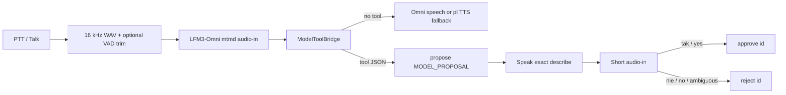

# Voice actions

Status: **V1 shipped on `main`; V2–V6 and next work remain open**. Plan PR [#149](https://github.com/NotCherry/LFM3Pocket/pull/149) merged 2026-11-18; V1 implementation PR [#180](https://github.com/NotCherry/LFM3Pocket/pull/180) merged 2026-11-17 (closes #153–#158). Design record and ordered work breakdown below remain the reference for remaining phases. Builds on [`background-mode.md`](background-mode.md) and [`ANDROID_TOOLS.md`](../ANDROID_TOOLS.md).

**Epic:** [#167 Voice actions](https://github.com/NotCherry/LFM3Pocket/issues/167)  
**Issue index / audit snapshot:** [`voice-actions-issues.md`](voice-actions-issues.md)


## Audit status (2026-11-18)

Snapshot from repository state on branch `ao/voice-epic/root` and GitHub issue/PR state:

| Item | State | Evidence / notes |
| --- | --- | --- |
| Epic [#167](https://github.com/NotCherry/LFM3Pocket/issues/167) | OPEN | Tracking remains open until child work and evidence are complete. |
| Plan PR [#149](https://github.com/NotCherry/LFM3Pocket/pull/149) | MERGED (2026-11-18) | Planning/docs PR. |
| V1 implementation [#180](https://github.com/NotCherry/LFM3Pocket/pull/180) | MERGED (2026-11-17) | Closes #153–#158; ADR [0006](../adr/0006-voice-actions-loop.md), [`VOICE_LOOP_CHECKLIST.md`](../VOICE_LOOP_CHECKLIST.md), and voice runtime/tests/docs landed on `main`. |
| #153–#157 | CLOSED | V1 listen/audio-in/speech/confirm/tool-card+strings delivered per #180. |
| #158 | CLOSED (tracking) | Checklist template exists, but **arm64 device runs are not recorded** in-repo (VL-01–VL-06 need device identity, APK/SHA, and PASS/FAIL/NOT_RUN outcomes). Treat as remaining evidence gap for epic closure confidence. |
| #159–#166 | OPEN | No implementation PRs found at audit time. |
| Probe issues #150–#152 | CLOSED | Permission/label probes closed. |
| Labels/milestones | PARTIAL / owner action | Epic notes HTTP 403 prevented bot label/milestone creation/application; owner must verify/apply full `voice`/`phase-*`/`needs-device-test` labels and Voice V1–V6/Voice next milestones. |

Related open work touching voice/runtime (not child implementation PRs for #159–#166): [#204](https://github.com/NotCherry/LFM3Pocket/pull/204), [#206](https://github.com/NotCherry/LFM3Pocket/pull/206), [#207](https://github.com/NotCherry/LFM3Pocket/pull/207), [#208](https://github.com/NotCherry/LFM3Pocket/pull/208). Review these alongside V1 reliability before declaring the loop production-ready.

**Remaining to close #167:** deliver and merge #159–#166; resolve voice correctness/reliability follow-ups; record real arm64 VL-01–VL-06 evidence; complete owner label/milestone bookkeeping and keep epic/index in sync.


Hanami (`dev.notcherry.hanami`) already keeps LFM3 resident via a `specialUse` foreground service, posts Stop / Unload / Open (plus RemoteInput Ask) on the ongoing notification, bridges model text into `ToolCoordinator` proposals with shade + consent-sheet approval, accepts share/ASK intents, and exposes an opt-in loopback API that cannot call `approve`. **Untrusted text never authorizes an action.** Voice must reuse that path: spoken audio is another user turn into the loaded multimodal model, and spoken confirm resolves a pending proposal id. It is not a second authorization channel.

The milestone:

1. Hands-free voice interaction that can request and, after confirmation, perform phone actions.
2. Phase 1 is the **voice loop**: push-to-talk → capture → **LFM3-Omni (or other audio-capable LFM3 multimodal GGUF) via llama.cpp `mtmd`** → tool bridge → spoken reply, including with the screen off while the model service is running. Polish is a first-class spoken language.
3. Approvals can be spoken: the app reads back the exact pending action, the user says tak/nie or yes/no, and only that maps to `approve(id)` / `reject(id)`.
4. First action set (user-chosen): timers/alarms/reminders, sending messages, calendar read/write, reading and summarizing notifications.

**Decision (locked):** speech input goes through the multimodal model itself (audio-in). Do **not** use Android `SpeechRecognizer`, whisper.cpp, or Vosk as the primary (or parallel) path — small Whisper packs handle Polish poorly, and a second ASR stack fights Omni for RAM.

## Current state (relevant bits)

| Piece | Today | Voice implication |
| --- | --- | --- |
| Model residency | `ModelRuntimeService` `specialUse` (+ `mediaPlayback` while speaking) | Screen-off turns already in scope for generation and spoken playback |
| Mic capture | `AudioRecord` 16 kHz mono PCM16 → private WAV (`RecordingController`); cancels in activity `onStop` | Reuse format; background PTT needs `microphone` FGS for the listen window only |
| Audio-in | `generateWithMedia` + matching `mmproj`; chat today often runs a separate Omni "Perform ASR" pass then answers from transcript | Voice-action loop should prefer **one** multimodal turn with the WAV attached (answer + optional tool JSON); keep ASR-as-history optional |
| Speech out | Omni `generateSpeech` / `mtmd_helper_gen_audio` (PCM16 mono, typically 24 kHz); `SpeechPrompt` already encodes language (`pl` / `en`) | Prefer Omni audio-out when `gen_audio` is present; system TTS with a Polish voice only as labelled fallback |
| Tools | Allowlisted JSON → `propose(MODEL_PROPOSAL)` → Approve/Reject | Voice confirm is `approve`/`reject` on the pending id |
| Timer / alarm | `AlarmClock` intents; timer `SAFE`, alarm `CONFIRM` | Keep; reminders are new |
| Notification listener | Not shipped | New, default off, summarize-on-request |
| Loopback / share text | Untrusted for authorization | Same for notification/calendar/message bodies; Omni audio is user origin for the turn, not for tool args invented in the reply |

## Design invariants

1. Captured PTT audio is a **user media attachment** on a normal generate path (`MODEL_PROPOSAL` for any tool JSON in the reply). It is never `USER_ACTION` for tool arguments the model invented.
2. Notification bodies, calendar descriptions, SMS/WhatsApp preview text, and other retrieved content enter the prompt as data (`DOCUMENT` / equivalent). They cannot call `propose` or `approve`.
3. Spoken "tak" / "yes" only resolves a **single, already-pending** proposal whose exact `describe` read-back the user just heard. No free-form "tak, wyślij do Mamy" from ambient audio.
4. Screen-off work rides the existing foreground service. No always-on mic in Phase 1.
5. Fail closed: mic denial, no audio-capable model (unless labelled fallback), empty/clip failure, ambiguous confirmation, expired proposal, missing permission → spoken error + shade update, no side effect.

## Phase 1 — voice loop

### Interaction

**Recommended: push-to-talk (PTT) first.**

| Control | Behavior |
| --- | --- |
| In-app hold-to-talk | Existing mic affordance; while held, capture; on release, run multimodal generate with the WAV |
| Shade action "Talk" | Timed listen window (e.g. 8 s, cancelable). Requires `microphone` FGS for that window. Shade: "Listening…" → "Thinking…" (no third-party "Heard: …" STT line required) |
| Hardware / headset PTT | Nice later; same listen session API |
| Screen off | Only while `ModelRuntimeService` is already foreground; start listen from shade Talk or prior in-app arm |

Listen window: partial wake lock + `FOREGROUND_SERVICE_TYPE_MICROPHONE` on top of `specialUse`. Drop `microphone` when capture ends. Keep `mediaPlayback` only while audio plays.

### Audio capture, resampling, chunking / VAD

Reuse `RecordingController` / `AndroidMicrophone` contracts:

| Item | Spec |
| --- | --- |
| Capture | `AudioRecord`, `MIC`, **16 kHz**, mono, PCM16 LE |
| Container | Private cache WAV (existing writer); delete after the turn finishes (today's cleanup rule) |
| Resample | Capture stays 16 kHz. If a future projector documents a different native rate, resample **once** before `mtmd` ingest (libsamplerate or a small JNI resampler) — do not rely on Android `SpeechRecognizer` resampling |
| Max length | Cap PTT (e.g. 15–30 s) so audio tokens + LFM3 fit RAM; existing `MAX_SAMPLES` is 60 s — tighten for voice-action turns |
| VAD / chunking | **PTT release is the primary end-of-utterance.** Optional energy VAD only to trim leading/trailing silence after release (faster encode, fewer tokens). Do **not** stream overlapping Omni chunks mid-utterance in V1 — one WAV per turn |
| Shade Talk timeout | End on silence (VAD) or hard timeout, whichever first; cancel drops the clip |

### Multimodal path (`mtmd`)

Already wired in `native.cpp`: load GGUF + matching `mmproj` → `mtmd_init_from_file` → on generate, `mtmd_helper_bitmap_init_from_file` for each media path → `mtmd_tokenize` with `<__media__>` markers → `mtmd_helper_eval_chunks` → text decode.

Voice-action turn:

1. Write WAV; attach as `VOICE_RECORDING`.
2. Build chat prompt with tool card + one `<__media__>` for the clip (Polish or English spoken content — Omni handles both; no separate language pack).
3. Single `generateWithMedia` → stream text → `ModelToolBridge` → optional `propose`.
4. Optional: persist a short user-visible transcript only if the model emits one or a cheap secondary "ASR-only" pass is requested for history — **not** required to authorize tools. Prefer answering from audio in one pass (avoids today's double Omni cost: ASR then reply).

**Fallback (labelled, only if loaded model has no audio input):** if there is no multimodal projector, or `mtmd` cannot ingest audio for this pair, show/speak a clear status ("This model cannot hear audio — load an LFM3-Omni GGUF with matching mmproj") and disable Talk / PTT for actions. Do **not** silently switch to `SpeechRecognizer`, Whisper, or Vosk. Text RemoteInput Ask remains available.

### Latency and memory (phone)

| Budget | Guidance |
| --- | --- |
| RAM | One Omni + mmproj only. No second ASR network. Idle residency unchanged; audio encode + KV for the clip is the spike |
| Threads | Stay within existing 1–8 inference thread setting; do not pin max during mic capture |
| Latency | Dominated by audio tokenize/eval then first text token. Trim silence; short tool-oriented replies; cap confirm clips to ~2 s |
| Thermal | Same ladder as background-mode; cancel listen at `SEVERE`+ |
| Concurrent speech out | Do not run `generateSpeech` while an audio-in generate holds `decode_mutex`; serialize (reply text first, then speech, or stream speech only after tool resolve) |

Measure on ARM64 Omni (existing probe protocol); treat x86_64 emulator Omni as wiring proof only.

### Speech output (audio-out vs Polish system TTS)

| Option | When |
| --- | --- |
| **Omni `generateSpeech` (recommended when available)** | Loaded pair reports `gen_audio` (`mtmd_gen_audio_get_info` ≠ none). Use `SpeechPrompt.tts(..., "pl" or "en", voice)` for replies and for confirmation read-backs of the **exact** `ToolCoordinator.describe` string (do not LLM-paraphrase the action) |
| **Fallback: Android `TextToSpeech` with a Polish voice** | Clearly labelled in Settings/status when Omni has no `gen_audio`, or speech generation fails. Prefer a installed `pl` voice; if missing, say so and fall back to English TTS or shade-only text — still never invent a cloud TTS path |
| Cloud TTS | Out of scope |

`docs/VOICE_OUTPUT.md` today rejects system TTS; voice-actions **amends** that for the no-`gen_audio` case only. Omni audio-out remains the default when the model can speak.

### Wake word vs PTT

| | PTT (Phase 1) | Always-on wake word |
| --- | --- | --- |
| Mic | Only while armed | Continuous |
| Cost | One Omni turn per press | Extra detector + false triggers |
| **Choice** | **Ship PTT** | Later; still cannot skip confirm |

### Small-model tool format (LFM3)

Keep one strict JSON object (`ToolRegistry` / `StrictToolJson`). Audio-in does not loosen parsing.

| Prompt approach | Trade-off |
| --- | --- |
| **Short tool card (recommended)** | Enabled tools + one example; "reply in the user's language (Polish or English) or emit exactly one JSON tool object" |
| Few-shot multi-example | Better recall, burns context |
| Free-form then scrape | Forbidden |
| Separate non-Omni command grammar | Out of path — would reintroduce a parallel NLU stack |

Confirmation after read-back: short PTT/confirm listen → Omni audio (or tiny confirm prompt) → match closed lexicon — **do not** ask the model "czy użytkownik zatwierdził?".

**Confirm lexicon (Polish + English):** approve: `tak`, `tak.`, `potwierdzam`, `yes`, `yep`, `confirm`; reject: `nie`, `nie.`, `anuluj`, `no`, `cancel`, `nope`. Case-fold, strip punctuation. Ambiguous → reject (optional one re-prompt).



## Action set

Every new power is a typed `ToolRegistry` row (or a read-only **context provider** that never calls `propose`). Risk and confirm rules below are for `MODEL_PROPOSAL`. Explicit in-app buttons with exact args remain `USER_ACTION` and may auto-run only when `SAFE`, unchanged from today.

### 1) Timers, alarms, reminders

**APIs / permissions**

| Capability | API | Permission / notes |
| --- | --- | --- |
| Timer (exists) | `AlarmClock.ACTION_SET_TIMER` | `SET_ALARM`; opens clock UI; app cannot verify creation |
| Alarm (exists) | `AlarmClock.ACTION_SET_ALARM` | Same |
| Reminder via notification | `Notification` + `WorkManager` / `AlarmManager` exact optional | `POST_NOTIFICATIONS`; prefer inexact + WorkManager; exact needs `SCHEDULE_EXACT_ALARM` / `USE_EXACT_ALARM` (policy-sensitive) |
| Reminder via calendar | `CalendarContract` | See calendar; heavier |

**Tool schemas (model-visible)**

```json
{"tool":"set_timer","arguments":{"seconds":300,"label":"Herbata"}}
{"tool":"set_alarm","arguments":{"hour":7,"minute":0,"label":"Pobudka"}}
{"tool":"set_reminder","arguments":{"when_epoch_sec":1731780000,"title":"Zadzwoń do dentysty","body":""}}
```

- `set_timer` / `set_alarm`: keep current validation.
- `set_reminder` (new): `when_epoch_sec` in a bounded window (e.g. now+60s … now+366 days); `title` ≤ 100; `body` ≤ 500; no HTML; reject past times.

**Risk / confirm**

| Tool | Risk | Voice confirm |
| --- | --- | --- |
| `set_timer` | `SAFE` (today) | Spoken read-back still recommended (duration); shade Approve OK when description fits |
| `set_alarm` | `CONFIRM` | Exact describe + tak/nie |
| `set_reminder` | `CONFIRM` | Exact describe + tak/nie |

**Variant:** reminder as calendar event vs local notification. **Recommended:** notification + WorkManager first (no calendar permission). Calendar-backed reminders after calendar tools + user-enabled write.

**Failure modes:** no clock app; background `startActivity` blocked; exact-alarm denied → inexact + spoken notice; notification permission denied → fail closed; reboot before WM runs → rely on WM persistence.

**Tests:** JVM schema bounds; coordinator risk; fake WM records time/title; approve posts exact title; reject/expiry schedules nothing; confirm lexicon (tak/nie/yes/no) with injected transcripts — no emulator ASR.

### 2) Sending messages (SMS / WhatsApp / etc.)

**APIs / permissions**

| Approach | API | Permissions | Play / F-Droid |
| --- | --- | --- | --- |
| **A. Draft via intent (recommended)** | `ACTION_SEND` / `ACTION_SENDTO` (`smsto:`, package-targeted share) | No `SEND_SMS` | Friendly |
| B. `SmsManager` send | `SmsManager.sendTextMessage` | `SEND_SMS`; Play-restricted | Prefer sideload-only if ever |
| C. WhatsApp without UI | No public send API | Accessibility / undocumented | Out of scope |

**Recommended:** draft → speak exact recipient + body → tak/nie → open composer intent. No silent send. No `SEND_SMS` in the default product.

**Tool schemas**

```json
{"tool":"draft_message","arguments":{"channel":"sms","to":"+48500111222","body":"Spóźnię się 10 minut"}}
{"tool":"draft_message","arguments":{"channel":"share","package":"com.whatsapp","body":"Już idę","to":""}}
{"tool":"send_message","arguments":{"draft_id":"…"}}
```

- `draft_message`: channel `sms` | `share`; bounded `to` / body; share package allowlist; immutable draft.
- `send_message`: only `draft_id` from the draft just read back (no body/to swap after confirm).

**Risk / confirm:** both `CONFIRM`. Intent-only yes opens the other app; spoken copy must say that.

**Failure modes:** no handler; app missing; draft expired; Play rejection if `SEND_SMS` added without need.

**Tests:** schema/package allowlist; draft immutability; approve records intent extras; planted "ignore and send SMS…" in notification text cannot authorize.

### 3) Calendar read / write

**APIs / permissions:** `CalendarContract`; `READ_CALENDAR` / `WRITE_CALENDAR`; user-picked `calendar_id` in Settings (never silent default write).

**Tool schemas**

```json
{"tool":"list_events","arguments":{"window_start_epoch_sec":1731700000,"window_end_epoch_sec":1731786400,"limit":20}}
{"tool":"create_event","arguments":{"title":"Standup","start_epoch_sec":1731744000,"end_epoch_sec":1731745800,"calendar_id":"3","all_day":false,"location":"","notes":""}}
{"tool":"update_event","arguments":{"event_id":"42","title":"Standup moved","start_epoch_sec":1731745800,"end_epoch_sec":1731747600}}
{"tool":"delete_event","arguments":{"event_id":"42"}}
```

Windows capped; `limit` ≤ 50; ids opaque. Tool results are untrusted data for summarization.

**Risk / confirm:** `list_events` `CONFIRM` first ship (or SAFE after a Settings read toggle); create/update/delete always `CONFIRM` with exact title/time/calendar in read-back.

**Failure modes:** permission denied; stale ids; timezone mistakes (device default zone in read-back).

**Tests:** validators; fake `ContentResolver`; revoke between propose and approve → `PERMISSION_DENIED`.

### 4) Reading and summarizing notifications

Context provider, not an authorizer.

**APIs:** `NotificationListenerService` + system enable; in-app per-app allowlist (default empty); master toggle default **off**.

```json
{"tool":"list_notifications","arguments":{"limit":20,"package":""}}
```

**Risk:** `CONFIRM` (or SAFE after toggle + non-empty allowlist). Returned text is `DOCUMENT`-class — planted tool JSON must create zero proposals (regression test).

**Failure modes:** listener disabled; empty allowlist; lock-screen redaction; reboot unbind.

## Voice confirmation protocol

1. Model emits tool JSON → `propose` → pending id.
2. Shade shows `describe`; speak that **exact** string (Omni speech or pl TTS fallback) + "Tak czy nie?" / "Yes or no?".
3. Short confirm listen → Omni audio-in → closed **tak/nie + yes/no** lexicon → `approve` / `reject`.
4. Ambiguous → reject (or one re-prompt). Never ask LFM3 whether they meant yes.
5. Expiry: shade hold (10 minutes from background-mode); do not expire mid read-back or during the confirm window.

## Platform: screen off and mic FGS

- Idle / generating: `specialUse` (today)
- Playing Omni/TTS audio: add `mediaPlayback`
- **PTT listening:** add `microphone` only for capture; manifest `FOREGROUND_SERVICE_MICROPHONE`

Android 12+: start mic FGS from notification `PendingIntent` or a started activity (shade Talk). Cancel listen on Stop, Unload, timeout, focus loss, thermal `SEVERE`+.

## Definition of Ready

A work item is **Ready** when:

1. It is linked from epic [#167](https://github.com/NotCherry/LFM3Pocket/issues/167) with a clear phase order.
2. Dependencies are named (issues or shipped main features). **Do not start work that duplicates in-progress quick-wins** (timers/alarms tools, built-in tool bridge polish, default-assistant entry, SAF model picker) — wait on or extend those.
3. Scope / out of scope and acceptance criteria are checkbox-ready in the issue.
4. Privacy/safety rules are acknowledged: exact action read-back + tak/nie (or yes/no) for side effects; notification/calendar/message/document text is untrusted.
5. Any new dangerous permission has a one-paragraph justification draft for the PR.
6. Test approach is named (JVM / instrumentation / arm64 checklist) — emulator ASR quality is not a merge gate.

## Definition of Done (project-wide)

Every voice-actions PR must satisfy:

- [ ] Code reviewed
- [ ] Unit tests added or updated; Android CI green
- [ ] Polish **and** English user-visible strings
- [ ] On-device manual test on an **arm64** phone using the checklist below (or explicit N/A with reason on the issue)
- [ ] No new dangerous permissions without PR justification
- [ ] Docs updated (this plan and any touched `docs/*`)
- [ ] Privacy/safety respected: exact `describe` read-back + tak/nie confirmation for side effects; notification (and similar) text treated as untrusted and cannot authorize actions

## Execution plan

Order is dependency order within a phase. Do not block **V1** on new tools — existing timer/alarm/flashlight on main exercise confirm + speech.

**External dependencies (do not duplicate):** timer/alarm tools ([#37](https://github.com/NotCherry/LFM3Pocket/issues/37), [#38](https://github.com/NotCherry/LFM3Pocket/issues/38)), tool bridge / built-in tools ([#147](https://github.com/NotCherry/LFM3Pocket/pull/147)), SAF GGUF import/picker ([#15](https://github.com/NotCherry/LFM3Pocket/issues/15) + any in-progress quick-wins picker), default-assistant entry quick-wins (coordinate in [#163](https://github.com/NotCherry/LFM3Pocket/issues/163)).

### Milestone Voice V1 — Voice loop — **SHIPPED (#180, 2026-11-17)**

#### [#153](https://github.com/NotCherry/LFM3Pocket/issues/153) Mic FGS listen session (PTT + shade Talk)

| | |
| --- | --- |
| **Scope** | 16 kHz WAV capture; optional silence trim; mic FGS only while listening; shade Talk `PendingIntent`; cancel/timeout paths |
| **Deps** | Residency + N2 notification on main (#143, #147) |
| **Approach** | Extend `ModelRuntimeService` types; reuse `RecordingController`; PTT release = EOU |
| **Risks** | OEM blocks background mic FGS; stuck Listening state |
| **Accept** | Screen-off Talk works while model FGS running; mic type only during capture |
| **Tests** | JVM listen state machine; instrumentation shade Talk + cancel |

#### [#154](https://github.com/NotCherry/LFM3Pocket/issues/154) One-pass Omni audio-in + no-audio disable

| | |
| --- | --- |
| **Scope** | One `generateWithMedia` turn with WAV; Polish/English; disable Talk if no audio-capable model |
| **Deps** | #153; Omni+mmproj load / SAF picker (quick-wins — do not rebuild) |
| **Approach** | Prefer audio→reply(+tool) over ASR-then-text double pass for voice-action sessions |
| **Risks** | RAM/latency; text-only GGUF confusion |
| **Accept** | Polish PTT grounded reply; no SpeechRecognizer/whisper/Vosk; clear disable copy |
| **Tests** | Fake engine media once; no-audio labelled error; ARM64 Polish sample |

#### [#155](https://github.com/NotCherry/LFM3Pocket/issues/155) Spoken output: Omni speech + Polish system TTS fallback

| | |
| --- | --- |
| **Scope** | Omni `generateSpeech` when `gen_audio`; labelled `TextToSpeech` + `pl` voice otherwise; exact describe for confirms |
| **Deps** | #154; existing V04/V05 speech on main |
| **Approach** | Amend `VOICE_OUTPUT.md` for labelled fallback only |
| **Risks** | Missing OEM Polish TTS voice; concurrent decode/speech |
| **Accept** | Omni pl speech works; fallback labelled; Stop interrupts |
| **Tests** | SpeechPrompt pl/en; fake playback; device checklist |

#### [#156](https://github.com/NotCherry/LFM3Pocket/issues/156) Voice confirmation (exact read-back + tak/nie)

| | |
| --- | --- |
| **Scope** | Exact `describe` spoken; short confirm listen; closed pl+en lexicon → `approve`/`reject`; ambiguous → reject |
| **Deps** | #153–#155; `ToolCoordinator` on main |
| **Approach** | Lexicon match only; never ask LFM3 if they meant yes |
| **Risks** | False approve from media noise; expiry mid read-back |
| **Accept** | Alarm needs confirm; tak/yes once; nie/no rejects; replay inert |
| **Tests** | JVM lexicon; coordinator; injected confirm transcripts |

#### [#157](https://github.com/NotCherry/LFM3Pocket/issues/157) Voice tool prompt card + pl/en strings

| | |
| --- | --- |
| **Scope** | Short tool card; all voice UX strings in `values` + `values-pl` |
| **Deps** | #154–#156 call sites |
| **Approach** | One JSON object instruction; no prose scrape |
| **Risks** | Context burn from over-long few-shot |
| **Accept** | Locale switch shows pl/en; StrictToolJson unchanged |
| **Tests** | Resource key presence; prompt unit assert |

#### [#158](https://github.com/NotCherry/LFM3Pocket/issues/158) Arm64 voice-loop device checklist — **tracking closed; device evidence still unrecorded**

| | |
| --- | --- |
| **Scope** | Checklist + recorded PASS/FAIL/NOT_RUN on physical arm64 (Polish PTT, shade Talk screen-off, tak/nie, text-only disable, Stop) |
| **Deps** | #153–#157 |
| **Approach** | Same evidence honesty as `ARM64_OMNI_TEST_PROTOCOL.md` |
| **Risks** | Fabricated PASS; emulator-only evidence |
| **Accept** | Checklist in repo; device identity + outcomes filed |
| **Tests** | Manual arm64 only |

**V1 done when:** screen off + Omni loaded → Polish Talk → reply; confirm tak/nie; text-only GGUF disables Talk clearly.

### Milestone Voice V2 — Reminders — **OPEN**

#### [#159](https://github.com/NotCherry/LFM3Pocket/issues/159) `set_reminder` via notification + WorkManager

| | |
| --- | --- |
| **Scope** | New tool; `CONFIRM`; inexact WM default; survive process death |
| **Deps** | Existing timer/alarm (#37, #38) — **do not reimplement**; #156 for voice path |
| **Approach** | Schema bounds; fake WM in tests; exact alarm only with justified permission |
| **Risks** | Play exact-alarm policy; OEM notification delay |
| **Accept** | Approve schedules exact title; reject/expiry none; fires after force-stop |
| **Tests** | JVM schema + fake WM; injected voice confirm |

### Milestone Voice V3 — Messages — **OPEN**

#### [#160](https://github.com/NotCherry/LFM3Pocket/issues/160) `draft_message` + `send_message` (intent path)

| | |
| --- | --- |
| **Scope** | Draft → read-back → confirm → `ACTION_SENDTO` / allowlisted share; no default `SEND_SMS` |
| **Deps** | #156 |
| **Approach** | Immutable draft; `send_message` only `draft_id` |
| **Risks** | Background activity start; Play SMS scrutiny if someone adds `SmsManager` |
| **Accept** | Intent extras correct; injection cannot authorize; no `SEND_SMS` from this work |
| **Tests** | Schema/allowlist; fake intents; injection fixture |

### Milestone Voice V4 — Calendar — **OPEN**

#### [#161](https://github.com/NotCherry/LFM3Pocket/issues/161) Calendar read/write tools + calendar picker

| | |
| --- | --- |
| **Scope** | list/create/update/delete; Settings `calendar_id`; READ/WRITE_CALENDAR justified |
| **Deps** | #156 |
| **Approach** | Bounded windows; opaque ids; results untrusted |
| **Risks** | Sync adapters; timezone mistakes |
| **Accept** | No write without pick+permission; stale id fails; revoke → PERMISSION_DENIED |
| **Tests** | Fake ContentResolver; validators; optional device smoke |

### Milestone Voice V5 — Notifications — **OPEN**

#### [#162](https://github.com/NotCherry/LFM3Pocket/issues/162) Notification listener + `list_notifications`

| | |
| --- | --- |
| **Scope** | Default-off listener; per-app allowlist; summarize-on-request; no tap/dismiss yet |
| **Deps** | #156 |
| **Approach** | `DOCUMENT`-class results; planted tool JSON → zero proposals |
| **Risks** | Spyware appearance; lock-screen redaction |
| **Accept** | Default off; allowlist filter; injection regression green |
| **Tests** | JVM allowlist + injection; unbound service error |

**Implementation status (landed on `main`):** opt-in `HanamiNotificationListenerService` (system-bound, requires user grant in Android notification access settings) + app-level master toggle and package allowlist in Settings (default off, empty deny-all). `list_notifications` tool added with bounded `limit`/`package` args, CONFIRM risk, and `UNTRUSTED_NOTIFICATION_DATA` results. System enable flow exposed from Settings. On-device validation remains required for bound listener behavior/redaction/runtime UX.

### Milestone Voice V6 — Default assistant — **OPEN**

#### [#163](https://github.com/NotCherry/LFM3Pocket/issues/163) Default Android assistant role (coordinate, do not duplicate)

| | |
| --- | --- |
| **Scope** | `ROLE_ASSISTANT` / `VoiceInteractionService` opens Hanami voice session; consent unchanged |
| **Deps** | V1 complete; **in-progress quick-wins default-assistant entry** (extend, do not fork); residency #143; SAF picker as load path |
| **Approach** | Single system entry → resident Omni session; cold start loads GGUF |
| **Risks** | Play assistant policy; latency without residency |
| **Accept** | Role grant + gesture opens Hanami; tools still confirm; one entry path with quick-wins |
| **Tests** | Manual arm64; bootstrap intent unit tests |

### Milestone Voice next — After voice — **OPEN**

#### [#164](https://github.com/NotCherry/LFM3Pocket/issues/164) GPU/NPU acceleration spike (Vulkan first)

CPU-only today (`n_gpu_layers = 0`). Spike **Vulkan** first for Omni PTT TTFT; then OpenCL notes; Hexagon/QNN as SoC-only experiment. Clean CPU fallback. Report devices, deltas, recommendation. Depends on stable V1 workload.

#### [#165](https://github.com/NotCherry/LFM3Pocket/issues/165) Rolling memory summarization

User-visible summarize-and-compact for long voice sessions; Room keeps full transcript; keep trim/thermal unload. Fail closed if summary fails.

#### [#166](https://github.com/NotCherry/LFM3Pocket/issues/166) Local document chat (SAF, untrusted)

Few-file SAF attach; chunk into prompt; cite filenames; `DOCUMENT`-class injection rules. Reuse SAF patterns from model import quick-wins — do not rebuild the GGUF picker.

Implementation note: text documents can be attached from SAF, read with size limits, chunked/windowed into prompt context as untrusted material with filename citations, and summarized in replies. Document-tainted turns suppress tool proposals so planted tool JSON in a document creates zero proposals. Unsupported or too-large files (including PDFs, where in-app text extraction is not yet available) fail with a clear error.

### Arm64 manual checklist (V1)

Record device, APK SHA, Omni+mmproj SHA, then:

| ID | Action | Expect |
| --- | --- | --- |
| VL-01 | Omni loaded; Polish PTT command | Grounded local reply; no network STT |
| VL-02 | Shade Talk, screen off | Listen → reply while FGS up |
| VL-03 | Propose alarm; say **tak** | Exact read-back; approve once |
| VL-04 | Propose; say **nie** / garbage | Reject; no side effect |
| VL-05 | Text-only GGUF | Talk disabled; clear pl+en message |
| VL-06 | Stop during listen / speech | Clean idle; no stuck FGS mic |

### Labels and milestones (owner)

Issue create works for this agent; **creating labels and milestones returned HTTP 403**. Please create labels `voice`, `epic`, `phase-1`…`phase-6`, `phase-next`, `android`, `needs-device-test` and the Voice V1–V6 / Voice next milestones, then apply them to [#167](https://github.com/NotCherry/LFM3Pocket/issues/167) and [#153](https://github.com/NotCherry/LFM3Pocket/issues/153)–[#166](https://github.com/NotCherry/LFM3Pocket/issues/166). Probe issues #150–#152 are closed (verified 2026-11-18).

## Out of scope (explicit)

- Accessibility-service UI automation
- Always-on wake word as the first mic story (assistant role is V6, still PTT/session based)
- External devices / LAN bind / Wear (loopback stays text-only, cannot approve)
- **Separate STT stacks:** `SpeechRecognizer`, whisper.cpp, Vosk (including as silent fallback)
- Cloud STT/TTS
- Scraping tool calls from notification or message text
- `SmsManager` silent send in the default build
- Shell bridge, arbitrary intents, model-supplied action strings
- Auto-grant tools for the voice session
- Emulator ASR quality gates as merge blockers (inject audio fixtures / confirm text)

## Risks

- **Omni audio latency / RAM on mid phones.** Mitigation: silence trim, short caps, one-pass audio→reply, serialize speech-out, measure on ARM64.
- **Text-only GGUF loaded.** Mitigation: labelled disable of Talk; RemoteInput remains.
- **Polish TTS gaps on OEM system voices.** Mitigation: prefer Omni `gen_audio` with `pl`; system TTS only when labelled; shade text always shows describe.
- **Confirm spoofing.** Mitigation: closed lexicon, short window, armed listen only, ambiguous → reject.
- **Play mic + specialUse + later ROLE_ASSISTANT scrutiny.** Mitigation: GitHub Releases first; declarations/videos when Play matters; assistant role does not bypass consent.
- **Background activity starts for clock/SMS.** Mitigation: run from approval UI / notification foreground start.
- **SMS / notification-listener policy.** Mitigation: intents-first messaging; listener default off + allowlist.

## Open decisions

Locked or recommended defaults:

1. **Speech in.** **Locked:** LFM3 multimodal audio-in (`mtmd`). No SpeechRecognizer / whisper / Vosk primary path.
2. **No-audio model.** **Locked:** disable voice-action mic with a clear message; text Ask still works.
3. **Speech out.** Recommended: Omni `generateSpeech` when `gen_audio` exists; labelled system TTS with Polish voice otherwise.
4. **PTT vs wake word.** Recommended: PTT / shade Talk in V1; wake word later.
5. **Confirm UX.** Recommended: exact describe read-back; tak/nie + yes/no; ambiguous → reject.
6. **Reminders.** Recommended: notification + WorkManager before calendar.
7. **Messaging.** Recommended: draft + intent; no default `SEND_SMS`.
8. **Calendar reads.** Recommended: `CONFIRM` each list until a Settings toggle exists.
9. **Notification listener.** Recommended: default off, empty allowlist, summarize-on-request.
10. **LFM3 tool prompt.** Recommended: short tool card; one JSON object; no prose scrape.
11. **Default assistant role.** Recommended: V6 after V1–V5; still consent-gated; residency expected for acceptable latency.

## Meaningful test plan (not coverage filler)

| Layer | What to prove |
| --- | --- |
| JVM listen session | Idle → listening → WAV ready → cancelled/timeout; mic FGS flag only while listening; silence trim bounds |
| Confirm lexicon | tak/nie/potwierdzam/yes/no/cancel; garbage → reject; empty → reject |
| Native/Omni wiring | Existing media path accepts 16 kHz WAV; no-audio model returns labelled error (fake engine + one ARM64 probe) |
| Tool schemas / coordinator | New tools; voice path still `MODEL_PROPOSAL`; approve once; expiry; permission revoke |
| Injection | Notification/SMS/calendar text with tool JSON → zero proposals |
| Fake clock/WM/SMS/Calendar | Side effects only after approve |
| Instrumentation | Shade Talk + screen off submits audio turn with FGS mic type; inject WAV fixture / confirm text — no SpeechRecognizer dependency |

## References

- Background mode / FGS / consent: [`background-mode.md`](background-mode.md)
- Tool contract: [`ANDROID_TOOLS.md`](../ANDROID_TOOLS.md)
- Local speech out (Omni): [`VOICE_OUTPUT.md`](../VOICE_OUTPUT.md)
- ARM64 Omni evidence: [`ARM64_OMNI_TEST_PROTOCOL.md`](../ARM64_OMNI_TEST_PROTOCOL.md)
- FGS microphone type: https://developer.android.com/develop/background-work/services/fgs/service-types
- RoleManager assistant: https://developer.android.com/reference/android/app/role/RoleManager
- VoiceInteractionService: https://developer.android.com/reference/android/service/voice/VoiceInteractionService
- AlarmClock: https://developer.android.com/reference/android/provider/AlarmClock
- CalendarContract: https://developer.android.com/reference/android/provider/CalendarContract
- NotificationListenerService: https://developer.android.com/reference/android/service/notification/NotificationListenerService
- SMS / Play permissions policy: https://support.google.com/googleplay/android-developer/answer/9214102
