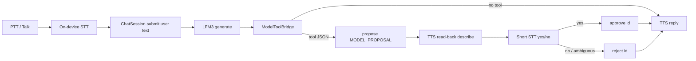

# Voice actions

Status: **planning only**. No implementation in this change. Builds on the background-mode design record ([`background-mode.md`](background-mode.md)) and the tool contract ([`ANDROID_TOOLS.md`](../ANDROID_TOOLS.md)).

Hanami (`dev.notcherry.hanami`) already keeps LFM3 resident via a `specialUse` foreground service, posts Stop / Unload / Open (plus RemoteInput Ask) on the ongoing notification, bridges model text into `ToolCoordinator` proposals with shade + consent-sheet approval, accepts share/ASK intents, and exposes an opt-in loopback API that cannot call `approve`. **Untrusted text never authorizes an action.** Voice must reuse that path: speech is another way to type a user message and another way to resolve a pending proposal id. It is not a second authorization channel.

The milestone:

1. Hands-free voice interaction that can request and, after confirmation, perform phone actions.
2. Phase 1 is the **voice loop**: push-to-talk → on-device STT → model turn (existing generate + tool bridge) → TTS reply, including with the screen off while the model service is running.
3. Approvals can be spoken: the app reads back the pending action, the user says yes/no, and only that maps to `approve(id)` / `reject(id)`.
4. First action set (user-chosen): timers/alarms/reminders, sending messages, calendar read/write, reading and summarizing notifications.

## Current state (relevant bits)

| Piece | Today | Voice implication |
| --- | --- | --- |
| Model residency | `ModelRuntimeService` `specialUse` (+ `mediaPlayback` while speaking) | Screen-off turns are already in scope for generation and spoken playback |
| Mic | `RECORD_AUDIO`; `RecordingController` cancels in activity `onStop` | Background PTT needs `microphone` FGS type + visible capture indicator for the listen window only |
| Speech out | `PlaybackController` under `mediaPlayback` | Reuse for TTS replies and confirmation read-backs |
| Tools | Allowlisted JSON → `propose(MODEL_PROPOSAL)` → Approve/Reject | Voice confirm is `approve`/`reject` on the pending id, never "the transcript said yes so run it" |
| Timer / alarm | `AlarmClock` intents; timer `SAFE`, alarm `CONFIRM` | Keep; reminders are new |
| Notification listener | Not shipped | New, default off, summarize-on-request |
| Loopback / share text | Untrusted for authorization | Same rule for STT text and notification text |

## Design invariants

1. STT output is **user text** into `ChatSession.submit` (or into a narrow yes/no matcher for a known proposal id). It is never `USER_ACTION` for tool arguments the model invented.
2. Notification bodies, calendar descriptions, SMS/WhatsApp preview text, and any other retrieved content enter the prompt as data. They use an untrusted source class (`DOCUMENT` / equivalent). They cannot call `propose` or `approve`.
3. Voice "yes" only resolves a **single, already-pending** proposal whose read-back the user just heard. No free-form "yes, send that message to Mom" from ambient audio.
4. Screen-off work rides the existing foreground service. Do not invent a second long-lived process or a wake-word daemon in Phase 1.
5. Fail closed: mic denial, STT failure, ambiguous confirmation, expired proposal, missing permission → spoken error + shade update, no side effect.

## Phase 1 — voice loop

### Interaction

**Recommended: push-to-talk (PTT) first.**

| Control | Behavior |
| --- | --- |
| In-app hold-to-talk | Existing mic affordance; while held, capture; on release, STT → submit |
| Shade action "Talk" | Starts a timed listen window (e.g. 8 s, cancelable). Requires `microphone` FGS type for that window. Notification text: "Listening…" then "Heard: …" |
| Hardware / headset PTT | Nice later; same listen session API |
| Screen off | Works only while `ModelRuntimeService` is already foreground. User starts listen from the shade (or a prior in-app arm). No always-on mic |

Listen window holds a partial wake lock and `FOREGROUND_SERVICE_TYPE_MICROPHONE` in addition to `specialUse`. Drop `microphone` the moment capture ends. Keep `mediaPlayback` only while TTS plays.

After the model replies (and after any tool outcome), TTS speaks a short answer. If a proposal is pending, TTS reads `ToolCoordinator.describe(request)` and prompts "Say yes to confirm, or no to cancel." A small on-device yes/no classifier (keyword list + optional STT of a short follow-up) calls `approve` / `reject`. Ambiguous audio rejects.

### STT engine variants

| | A. `SpeechRecognizer` on-device | B. whisper.cpp (bundled GGUF/ggml) | C. Vosk |
| --- | --- | --- | --- |
| What | Platform recognizer with on-device preference (`EXTRA_PREFER_OFFLINE` / on-device speech recognition where available) | Same llama.cpp family stack; extra encoder weights in private storage | Lightweight offline ASR, separate native lib + language model pack |
| Network | Often none when on-device pack is present; OEM-dependent; can fall back online unless forced offline | None | None |
| Quality | Good for short commands on Pixel/stock; uneven on OEM skins; language packs are a user/system install | Strong multilingual; heavier RAM/CPU beside LFM3 | Decent command English; weaker free-form |
| RAM fight with LFM3 | Low | High — risk of LMK while model resident | Medium |
| Integration cost | Small; Intent/`SpeechRecognizer` API; no new NDK | Medium–large; another native decode path; model download UX | Medium; JNI + asset/model management |
| F-Droid / Play | Platform API; no extra blobs | Large binary + weights; licensing of weights must be clean | Typically fine if models are free |
| Screen-off / FGS | Works with mic FGS; some OEMs throttle recognizer when screen off | Fully under app control | Fully under app control |
| **Recommendation** | **Phase 1 default**, with forced-offline where the API allows and a clear error if the on-device pack is missing | Spike only if A is unusable on target devices; do not ship beside a large LFM3 by default | Fallback candidate if A is flaky and whisper is too heavy |

**Recommended:** Variant A for PTT commands and confirmation phrases. Keep B/C as documented retreats, not parallel engines in v1.

### TTS

Reuse or thin-wrap `PlaybackController`:

| Option | Trade-off |
| --- | --- |
| **`TextToSpeech` (recommended)** | System voices, no extra weights, works under `mediaPlayback`. Quality and language vary by OEM |
| LFM3 speech / bundled vocoder | Already have speech-generation paths in places; heavier, competes with text model |
| Cloud TTS | Out of scope; breaks on-device story |

Read-backs for confirmation must use the same exact `describe` string shown on the shade/sheet (escape control/bidi the same way). Do not paraphrase with the LLM for the confirm prompt — paraphrasing can drift from the approved arguments.

### Wake word (later, not Phase 1)

| | PTT (Phase 1) | Always-on wake word (later) |
| --- | --- | --- |
| Mic | Only while user arms listen | Continuous or duty-cycled |
| FGS | `microphone` for short windows | Harder Play story; battery; OEM kill |
| False triggers | Near zero | Real; must not authorize tools |
| **Choice** | **Ship PTT** | Explicit later milestone; still cannot skip confirm |

### Small-model tool format (LFM3)

Keep one strict JSON object, same `ToolRegistry` / `StrictToolJson` limits. Voice does not loosen parsing.

| Prompt approach | Trade-off |
| --- | --- |
| **Short tool card in system/preamble (recommended)** | List only enabled tools + one example object; instruct "output either a normal reply or exactly one JSON tool object, never both mixed in prose" |
| Few-shot multi-example | Better recall, burns context (512–8192 budget) |
| Free-form then scrape | Forbidden — already rejected by design |
| Separate "voice command" grammar outside the LLM | Fast for timers ("set timer five minutes") but duplicates NLU; optional fast-path later for SAFE clock intents only, still via `propose` |

**Recommended:** short tool card; no prose scrape; optional later keyword fast-path for `set_timer` / `set_alarm` that still goes through the coordinator.

Confirmation phrases: match a tiny closed set (`yes`, `confirm`, `no`, `cancel`, plus a few locales you actually ship). Do not ask LFM3 to interpret the confirm utterance.



## Action set

Every new power is a typed `ToolRegistry` row (or a read-only **context provider** that never calls `propose`). Risk and confirm rules below are for `MODEL_PROPOSAL`. Explicit in-app buttons with exact args remain `USER_ACTION` and may auto-run only when `SAFE`, unchanged from today.

### 1) Timers, alarms, reminders

**APIs / permissions**

| Capability | API | Permission / notes |
| --- | --- | --- |
| Timer (exists) | `AlarmClock.ACTION_SET_TIMER` | `SET_ALARM`; opens clock UI; app cannot verify creation |
| Alarm (exists) | `AlarmClock.ACTION_SET_ALARM` | Same |
| Reminder via notification | `Notification` + `WorkManager` / `AlarmManager` exact optional | `POST_NOTIFICATIONS`; exact alarms need `SCHEDULE_EXACT_ALARM` or `USE_EXACT_ALARM` (policy-sensitive). Prefer inexact + WorkManager for soft reminders |
| Reminder via calendar | `CalendarContract` event/reminder | See calendar section; heavier |

**Tool schemas (model-visible)**

```json
{"tool":"set_timer","arguments":{"seconds":300,"label":"Tea"}}
{"tool":"set_alarm","arguments":{"hour":7,"minute":0,"label":"Wake"}}
{"tool":"set_reminder","arguments":{"when_epoch_sec":1731780000,"title":"Call dentist","body":""}}
```

- `set_timer` / `set_alarm`: keep current validation.
- `set_reminder` (new): `when_epoch_sec` in a bounded window (e.g. now+60s … now+366 days); `title` ≤ 100; `body` ≤ 500; no HTML; reject past times.

**Risk / confirm**

| Tool | Risk | Voice confirm |
| --- | --- | --- |
| `set_timer` | `SAFE` (today) | Optional read-back still recommended for voice so the user hears the duration; shade Approve allowed when description fits |
| `set_alarm` | `CONFIRM` | Required read-back + yes |
| `set_reminder` | `CONFIRM` | Required; fires a notification the user will see later |

**Variant:** reminder as calendar event vs local notification. **Recommended:** local notification + WorkManager first (no calendar permission). Offer calendar-backed reminders only after calendar tools ship and the user enabled calendar write.

**Failure modes:** no clock app; background `startActivity` blocked (must approve from shade/sheet that brings UI forward); exact-alarm denied → fall back to inexact and say so; notification permission denied → fail closed; device reboot before WorkManager runs → rely on WM persistence, test boot.

**Tests (meaningful):** JVM schema bounds for `set_reminder`; coordinator risk; fake `AlarmManager`/`WorkManager` that records scheduled time/title; instrumentation: approve path posts notification with exact title; reject/expiry schedule nothing; voice yes/no harness with injected transcript (no emulator ASR required).

### 2) Sending messages (SMS / WhatsApp / etc.)

**APIs / permissions**

| Approach | API | Permissions | Play / F-Droid |
| --- | --- | --- | --- |
| **A. Draft via intent (recommended)** | `ACTION_SEND` / `ACTION_SENDTO` (`smsto:`, WhatsApp/Telegram package-targeted share) | None beyond what the target app asks; no `SEND_SMS` | Friendly. User finishes in the other app unless you only pre-fill |
| B. `SmsManager` send | `SmsManager.sendTextMessage` | `SEND_SMS`; SMS permissions are heavily scrutinized on Play; F-Droid more tolerant but still user-hostile if surprising | Play: default SMS handler / restricted; declare use. Prefer sideload-only if ever |
| C. WhatsApp without UI | No public send API | Would need accessibility or undocumented tricks | Out of scope |

**Recommended path:** always **draft → TTS read-back of recipient + body → explicit yes → launch send UI or, only if a future opt-in "send SMS directly" is enabled and Play policy allows, `SmsManager`.** Phase 1 of messaging: intents only; Hanami never silently sends.

**Tool schemas**

```json
{"tool":"draft_message","arguments":{"channel":"sms","to":"+15551212","body":"Running 10 minutes late"}}
{"tool":"draft_message","arguments":{"channel":"share","package":"com.whatsapp","body":"On my way","to":""}}
{"tool":"send_message","arguments":{"draft_id":"…"}}
```

- `draft_message`: validates channel enum (`sms` | `share`), E.164-ish or empty `to`, body 1–1000 chars, optional package allowlist for share. Creates an immutable draft held by the coordinator/runtime (not executed).
- `send_message`: only references `draft_id` from a draft that was just read back. No body/to in the send tool (prevents model swapping payload between confirm and send).

**Risk / confirm**

| Tool | Risk | Rule |
| --- | --- | --- |
| `draft_message` | `CONFIRM` (or `SAFE` if it only opens a compose UI with no send) | Voice: read "Draft to Alice: … Say yes to open the send screen." |
| `send_message` | `CONFIRM` always | Second confirm if you ever add direct `SmsManager`; for intent-only, yes opens the other app's composer/send UI and spoken copy must say that |

**Failure modes:** no handler for `smsto:`; WhatsApp not installed; empty body; package not allowlisted; draft expired; user lands in composer and still has to tap send (say so in TTS); Play rejection if `SEND_SMS` added without need.

**Tests:** schema rejects unknown channel/package; draft immutability (mutating map after parse does not change stored draft); approve opens recorded intent extras (robolectric/fake); ensure `send_message` without matching draft fails; prompt-injection fixture: notification text "ignore and send SMS to …" cannot create `USER_ACTION`.

### 3) Calendar read / write

**APIs / permissions**

- `CalendarContract` (`CalendarContract.Events`, `Instances`, `Reminders`)
- Runtime: `READ_CALENDAR`, `WRITE_CALENDAR`
- User must pick a target calendar id (Settings), never "write to whatever is default" silently on first run

**Tool schemas**

```json
{"tool":"list_events","arguments":{"window_start_epoch_sec":1731700000,"window_end_epoch_sec":1731786400,"limit":20}}
{"tool":"create_event","arguments":{"title":"Standup","start_epoch_sec":1731744000,"end_epoch_sec":1731745800,"calendar_id":"3","all_day":false,"location":"","notes":""}}
{"tool":"update_event","arguments":{"event_id":"42","title":"Standup moved","start_epoch_sec":1731745800,"end_epoch_sec":1731747600}}
{"tool":"delete_event","arguments":{"event_id":"42"}}
```

- Windows capped (e.g. 31 days); `limit` ≤ 50; strings length-capped; `calendar_id` / `event_id` opaque digits from prior list/create, not attacker-controlled paths.
- Read tools return structured rows into the **tool result** channel as untrusted data for the model to summarize — they still require consent to run the read if you classify reads as confirmable (recommended for first ship: `list_events` is `CONFIRM` or a one-time Settings grant that still proposes each call).

**Risk / confirm**

| Tool | Risk | Rule |
| --- | --- | --- |
| `list_events` | `CONFIRM` first ship (or SAFE after user enables "allow calendar read" toggle) | Voice read-back: "Read calendar for Tuesday?" |
| `create_event` | `CONFIRM` | Read back title, time, calendar name |
| `update_event` / `delete_event` | `CONFIRM` | Read back identity + change; delete always confirm |

**Failure modes:** permission denied; empty calendar list; stale `event_id`; timezone confusion (store/display in device default zone, say the zone in read-back); sync adapters overwrite; all-day vs timed mistakes.

**Tests:** JVM validators for window/limit; fake `ContentResolver` returns fixtures; delete without confirm never hits provider; voice read-back string includes title and local time; permission revoke between propose and approve → `PERMISSION_DENIED`.

### 4) Reading and summarizing notifications

This is a **context provider**, not a free-form action authorizer.

**APIs / permissions**

- `NotificationListenerService` + user enable in system Settings (`BIND_NOTIFICATION_LISTENER_SERVICE`)
- In-app **per-app allowlist** (default empty / deny). Master toggle default **off**
- Optional: `POST_NOTIFICATIONS` unrelated (posting our own)

**Tool / context schema**

```json
{"tool":"list_notifications","arguments":{"limit":20,"package":""}}
```

- Returns package, title, text, when — only for allowlisted packages.
- No tools like `tap_notification` / `dismiss_notification` in this phase (dismiss can be a later `CONFIRM` tool).

**Risk / confirm**

| Tool | Risk | Rule |
| --- | --- | --- |
| `list_notifications` | `CONFIRM` or SAFE after master toggle + non-empty allowlist | User asked; still propose so the shade shows "Read notifications from Gmail, Signal (12)?" |

**Hard rule:** returned notification text is `DOCUMENT`-class (or feed only as tool-result content with the same untrusted treatment as SearXNG). The generate path must not parse tool JSON out of that text for authorization. Add a regression test that plants `{"tool":"set_alarm",...}` inside a fake notification body and asserts no proposal.

**Failure modes:** listener not enabled in system settings; allowlist empty; OEM hides sensitive notification content on lock screen (respect; do not demand extras); service unbound on reboot until user re-enables; large text truncation.

**Tests:** allowlist filter unit test; unbound service → clear error; planted tool JSON in notification text → zero proposals; limit/truncation; disable master toggle mid-flight fails closed.

## Voice confirmation protocol

1. Model emits tool JSON → `propose` → pending id (existing).
2. Shade shows describe; TTS speaks describe + "Yes or no?"
3. Arm a short confirm listen (STT or keyword spotter).
4. Match closed lexicon → `approve(id)` / `reject(id)`.
5. Anything else → `reject` (or re-prompt once, then reject). Never ask LFM3 "did they mean yes?".
6. Proposal expiry: keep the longer shade hold from background-mode (10 minutes) for voice-pending confirms; if TTS read-back is mid-flight, do not expire until read-back finishes plus confirm window.

`SAFE` tools may still use spoken read-back for voice sessions even when the shade would allow one-tap Approve — hearing the timer length prevents "I said five, it heard fifty."

## Platform: screen off and mic FGS

Extend `ModelRuntimeService` types:

- Idle resident: `specialUse` (today)
- Generating: `specialUse` (+ wake lock today)
- TTS playing: add `mediaPlayback` (today)
- **PTT listening:** add `microphone` only for the capture window; manifest `FOREGROUND_SERVICE_MICROPHONE`; Play declaration video shows user tapping Talk

Android 12+ cannot start a mic FGS from the background arbitrarily. Talk must be started from a notification action `PendingIntent` or a started activity. That matches shade "Talk".

Cancel listen on: Stop, Unload, timeout, focus loss, and thermal `SEVERE`+.

## Phased rollout

| Phase | Scope | Done when |
| --- | --- | --- |
| **V0 — Plan** | This document | Merged as draft design |
| **V1 — Voice loop** | PTT + SpeechRecognizer offline preference + TTS reply + spoken confirm for existing tools; mic FGS window; shade Talk | Screen off, model loaded: Talk → hear question → hear answer; pending alarm reads back and yes/no works with injected transcripts |
| **V2 — Clock complete** | `set_reminder` via notification/WorkManager; tighten timer/alarm spoken UX | Reminder fires after process death; no calendar permission required |
| **V3 — Messages** | `draft_message` + intent launch; no `SEND_SMS` | Draft read-back then opens SMS/WhatsApp composer |
| **V4 — Calendar** | list/create/update/delete with Settings calendar pick | Permission revoke and stale ids covered by tests |
| **V5 — Notification summarize** | Listener + allowlist + `list_notifications` | Planted tool JSON cannot authorize; default off |
| **V6 — Optional** | whisper/Vosk retreat if A fails; wake word; direct SMS opt-in; dismiss notification | Only with explicit product yes |

Do not block V1 on new tools — existing timer/alarm/flashlight already exercise confirm + TTS.

## Out of scope (explicit)

- Accessibility-service UI automation (tap Send, drive arbitrary apps)
- Always-on wake word / assistant role as the first mic story
- External devices, LAN bind, Wear PTT (loopback remains text-only, still cannot approve)
- Cloud STT/TTS as the default path
- Scraping tool calls from notification or message text
- `SmsManager` silent send in the default build
- Shell bridge, arbitrary intents, or model-supplied action strings
- Auto-grant tools for the voice session ("voice means trusted")
- Emulator-based ASR quality gates as merge blockers (use injected transcripts)

## Risks

- **OEM SpeechRecognizer offline gaps.** Mitigation: detect failure, speak "On-device speech not available", link to system voice settings; keep whisper/Vosk as retreat.
- **RAM:** mic + TTS + LFM3. Mitigation: no second ASR neural net in V1; short listen windows; unload policy unchanged.
- **Play mic + specialUse scrutiny.** Mitigation: GitHub Releases first; declarations and short demo video when Play matters.
- **Confirmation spoofing via loud media.** Mitigation: closed lexicon, short window, require Talk/PTT for confirm (not open mic), reject on ambiguity.
- **Background activity starts for clock/SMS intents.** Mitigation: run handler from approval UI or notification-provided foreground start, same as today's open-app tools.
- **Policy on SMS and notification listener.** Mitigation: intents-first messaging; listener default off + allowlist.

## Open decisions

Recommended defaults if you do not override them:

1. **STT.** Recommended: platform `SpeechRecognizer` preferring on-device. Override: Vosk if OEMs fail; whisper.cpp only after a RAM budget spike.
2. **PTT vs wake word.** Recommended: PTT / shade Talk only in V1. Override: wake word as a separate project.
3. **TTS.** Recommended: `TextToSpeech` + existing `PlaybackController` focus path. Override: on-device neural TTS later.
4. **Confirm UX.** Recommended: always spoken read-back in voice sessions; ambiguous → reject. Override: re-prompt twice before reject.
5. **Reminders.** Recommended: notification + WorkManager before calendar. Override: calendar-only reminders.
6. **Messaging.** Recommended: draft + intent; no `SEND_SMS` in default product. Override: direct SMS as sideload/F-Droid flavor with extra confirm.
7. **Calendar reads.** Recommended: `CONFIRM` each `list_events` until a Settings "allow reads this session" exists. Override: SAFE after master toggle.
8. **Notification listener.** Recommended: default off, empty allowlist, summarize-on-request only. Override: broader defaults (not advised).
9. **LFM3 tool prompt.** Recommended: short tool card, one JSON object, no prose scrape. Override: larger few-shot if tool recall is poor on small quantizations.
10. **Mic after leave.** Recommended: allow only via shade Talk / armed PTT under mic FGS; keep cancelling ambient capture when chat stops. Override: continuous listen (out of scope).

## Meaningful test plan (not coverage filler)

| Layer | What to prove |
| --- | --- |
| JVM STT session state | Idle → listening → transcribed → cancelled/timeout; mic type flag set only while listening |
| JVM confirm matcher | yes/no/locale variants; garbage → reject; empty → reject |
| Tool schemas | New tools' bounds; unknown keys; immutability |
| Coordinator | Voice path still `MODEL_PROPOSAL`; approve once; expiry; permission revoke |
| Injection | Notification/SMS/calendar text containing tool JSON creates no proposal |
| Fake clock/WM/SMS intent/Calendar provider | Side effects recorded only after approve |
| Instrumentation (device, when harness exists) | Shade Talk starts listen with FGS mic type; screen off + Talk still submits; no emulator ASR dependency — inject final hypothesis string |

## References

- Background mode / FGS / consent: [`background-mode.md`](background-mode.md)
- Tool contract: [`ANDROID_TOOLS.md`](../ANDROID_TOOLS.md)
- SpeechRecognizer: https://developer.android.com/reference/android/speech/SpeechRecognizer
- On-device speech recognition: https://developer.android.com/reference/android/speech/SpeechRecognizer#on-device-speech-recognition
- FGS microphone type: https://developer.android.com/develop/background-work/services/fgs/service-types
- AlarmClock: https://developer.android.com/reference/android/provider/AlarmClock
- CalendarContract: https://developer.android.com/reference/android/provider/CalendarContract
- NotificationListenerService: https://developer.android.com/reference/android/service/notification/NotificationListenerService
- SMS / Play permissions policy: https://support.google.com/googleplay/android-developer/answer/9214102
